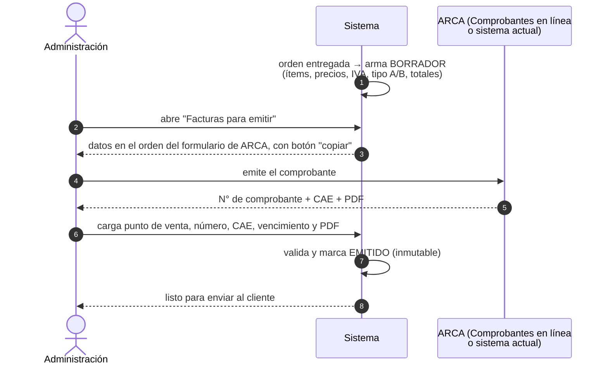
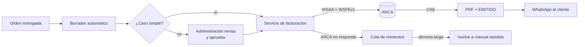

# Plan por etapas

| | Etapa 1 · Digitalización | Etapa 2 · Automatización |
|---|---|---|
| **Objetivo** | Todo digital, **una sola base de datos**, flujos principales funcionando | Que el sistema haga solo lo repetitivo |
| **Órdenes** | Carga manual (mostrador, teléfono, WhatsApp del celular) | **WhatsApp Business conectado**: la orden nace en el chat |
| **Avisos al cliente** | Los manda una persona | **Automáticos** (turno, recordatorio, listo, acta, factura) |
| **Facturación** | **Manual asistida**: el sistema arma todo, una persona emite en ARCA y carga el CAE | **Automática** con ARCA |
| **Stock** | Sólo catálogo de productos (se registra qué se usó en cada orden) | **Gestión inteligente**: reservas, alertas y compras sugeridas |
| **Seguridad** | **Completa desde el día 1** ([SEGURIDAD.md](SEGURIDAD.md)) | Se suma lo de las integraciones (WhatsApp, certificado de ARCA) |

**Por qué la seguridad no espera a la etapa 2:** desde el primer día entran DNIs, teléfonos y facturas. Agregar cifrado y passkeys después, con datos ya cargados, es más caro y más riesgoso.

---

## Etapa 1 · Digitalización

### Qué incluye

1. **Base de datos común**: clientes (con datos sensibles cifrados), vehículos (patente o VIN), órdenes, catálogo de **trabajos** (con duración y precio) y de **productos** (SKU, precio, IVA), usuarios y equipos.
2. **Carga manual de órdenes**: el vendedor las carga desde el mostrador, el teléfono o el **WhatsApp Business del celular de la empresa** (copiando los datos). Se registra el **origen** de cada orden. La carga es rápida:
   - Búsqueda por patente, nombre o teléfono.
   - Validación de patente y de CUIT (con dígito verificador).
   - Precios propuestos desde el catálogo.
3. **Flujos principales**: calendario y asignación, tablet del operario, firma de entrega con acta PDF e historial. Todo lo descripto en el [README](README.md).
4. **Facturación manual asistida** (ver abajo).
5. **Seguridad completa**: passkeys, cifrado y registro de seguridad ([SEGURIDAD.md](SEGURIDAD.md)).
6. **Plan de emergencia** operativo y probado ([PLAN-B.md](PLAN-B.md)).
7. **Reportes básicos**: órdenes por estado, trabajos por operario, **órdenes entregadas sin factura** y facturación del día y del mes.
8. **Importación de datos existentes** (si tienen planillas de clientes): se validan y se cifran al importarlas.

### Facturación manual asistida

**Qué controla el sistema solo** (lo garantiza la base y está probado en [`pruebas_schema.sql`](pruebas_schema.sql)):

| Control | Qué evita |
|---|---|
| Los totales tienen que coincidir con los ítems (neto e IVA por alícuota) | Facturar un monto distinto al de la orden |
| El CAE tiene que tener 14 dígitos | Un CAE mal copiado |
| **Numeración correlativa** por tipo y punto de venta | Un número mal tipeado (ej. 3 en vez de 2) |
| Número de comprobante único | Cargar dos veces la misma factura |
| Sólo **Administración** emite, confirmando con passkey | Que facture cualquiera |
| Una factura emitida **no se modifica ni se borra** | "Arreglos" sobre una factura ya presentada |
| Los errores se corrigen con **nota de crédito**, de la misma letra y sin superar el total | Notas de crédito inválidas |
| Nota de crédito por el total → factura **ANULADA** automáticamente | Estados inconsistentes |

**Requisito:** usar un **punto de venta exclusivo** para este sistema. Si lo comparte con otro sistema, la numeración tiene huecos legítimos y el control de correlatividad no se puede aplicar.

**El tipo de comprobante** (A o B) lo **sugiere** el sistema según la condición frente al IVA del cliente. Las reglas exactas se validan con el contador.

### Lo que la etapa 1 deja preparado para la etapa 2

| Etapa 2 | Lo que ya queda listo en la etapa 1 |
|---|---|
| WhatsApp conectado | El teléfono de cada cliente guardado de forma que se puede buscar al instante (HMAC); el origen de cada orden; **la verificación del negocio en Meta y las plantillas iniciadas** (llevan tiempo) |
| Stock inteligente | **Cada orden registra qué producto y cuánto se usó** → al llegar la etapa 2 hay meses de historial de consumo para calcular puntos de pedido |
| Facturación automática | La misma estructura de comprobante (tipo, punto de venta, número, CAE) con un campo `modo`: sólo cambia **quién** completa los datos. El punto de venta exclusivo y los controles ya están funcionando |

### Criterios para dar por terminada la etapa 1

- [ ] **2 semanas seguidas** con el 100 % de las órdenes en el sistema (papel sólo en emergencias)
- [ ] El 100 % de las órdenes entregadas tiene su comprobante cargado con PDF; **0 diferencias** de totales
- [ ] Simulacro de emergencia de nivel 2 resuelto en ≤ 10 min
- [ ] Checklist de seguridad completo ([SEGURIDAD.md §12](SEGURIDAD.md#12-checklist-antes-de-salir-a-producción)) y prueba de penetración sin hallazgos críticos
- [ ] Operarios y vendedores usándolo sin quejas de "se traba"

---

## Etapa 2 · Automatización

### Orden recomendado

| Paso | Qué | Por qué en este orden |
|---|---|---|
| **2a** | WhatsApp Business + avisos automáticos | Es lo que más se nota en el día a día y el riesgo es bajo |
| **2b** | Facturación automática | Tiene impacto fiscal: necesita un arranque gradual con controles |
| **2c** | Stock inteligente | Mientras tanto se juntan **más meses de historial de consumo**, que es lo que lo hace "inteligente" |

### 2a · WhatsApp Business y conexiones automáticas

- **API oficial de WhatsApp Business** (directo con Meta o mediante un proveedor). Los mensajes entran a una **bandeja compartida** en el sistema.
- Al escribir un cliente, **el sistema lo reconoce por su teléfono** y muestra sus vehículos y órdenes.
- **Crear la orden desde el chat**, con los datos precargados.
- **Avisos automáticos** con plantillas aprobadas por Meta:
  - Orden recibida
  - Turno asignado
  - Recordatorio 24 h antes
  - Vehículo listo
  - **Acta firmada (PDF)**
  - **Factura (PDF)**
- **Aviso de privacidad** en el primer mensaje (Ley 25.326).
- **Seguridad:**
  - Se verifica la firma de cada mensaje que llega (HMAC). Si no coincide, se descarta.
  - Los mensajes se guardan cifrados, con un plazo de conservación definido.
  - La clave de la API va al gestor de secretos.
- **Otras conexiones automáticas:** email como respaldo de WhatsApp, y exportación al sistema contable si hace falta.

### 2b · Facturación automática

- El sistema envía el comprobante a ARCA por **web service** (autenticación WSAA + factura electrónica WSFEv1), recibe el **CAE**, genera el PDF y lo manda por WhatsApp.
- **Nunca duplica una factura**: antes de reintentar, consulta a ARCA el último número autorizado.
- **El certificado digital de ARCA** se guarda en el gestor de secretos o el KMS, y **sólo lo usa el servicio de facturación** (ver [SEGURIDAD.md](SEGURIDAD.md)).
- **Arranque gradual:**
  1. **Homologación**: pruebas en el ambiente de testing de ARCA.
  2. **Modo sombra** (2 semanas): el sistema prepara cada factura automática y la **compara** con la que Administración sigue emitiendo a mano. Cero diferencias para avanzar.
  3. **Con aprobación**: el sistema emite cuando Administración toca "Emitir".
  4. **Automático** para los casos simples (ej. consumidor final, un solo tipo de IVA). Los casos especiales siguen con aprobación.
- **Si ARCA no responde:** la factura queda en cola y se reintenta. Si la demora es larga, se vuelve a **manual asistida**, el mismo flujo de la etapa 1, sin aprender nada nuevo. Evaluar con el contador el régimen de contingencia de ARCA (CAEA).
- **Decisión a tomar:**

| | Conexión directa con ARCA | Proveedor de facturación electrónica |
|---|---|---|
| Costo mensual | Sin abono | Abono por comprobante o mensual |
| Desarrollo | Más trabajo (certificados, web services) | Menos (su API es más simple) |
| Dependencia | Sólo de ARCA | De ARCA **y** del proveedor |
| Control y seguridad | Total; el certificado queda en casa | El certificado queda en el proveedor |

### 2c · Gestión inteligente de stock

**Modelo:** el stock **no es un número que se pisa**. Es la suma de un **libro de movimientos** que no se borra:

| Movimiento | Cuándo |
|---|---|
| Ingreso | Llega una compra del proveedor |
| **Reserva** | **Al agendar** una orden: se apartan sus productos |
| Liberación | Se cancela o se reprograma la orden |
| **Consumo** | El operario marca en la tablet lo que usó |
| Devolución | Vuelve un artículo sin usar |
| Ajuste | Inventario físico: **con motivo y aprobado por otra persona** |

**Lo "inteligente":**

1. **Disponible real = stock físico − reservado por la agenda.** Que haya 10 alarmas en el depósito no significa que haya 10 disponibles.
2. **Control al agendar**: si para la fecha del turno no va a haber stock, el coordinador lo ve en el calendario. A definir si se avisa o se bloquea.
3. **Alerta anticipada con la agenda**, por ejemplo: *"La semana que viene hay 12 alarmas agendadas y 8 en stock. El proveedor tarda 5 días: pedir hoy."*
4. **Punto de pedido por producto** = consumo promedio diario × demora del proveedor + stock de seguridad. Se calcula con el **historial de la etapa 1** y se recalcula solo.
5. **Compra sugerida semanal**: un borrador de orden de compra por proveedor, listo para revisar.
6. **Control de faltantes**: se compara el consumo real con el esperado de cada orden, y las diferencias generan una alerta. **Inventario cíclico**: cada semana se cuenta una parte, y los artículos de más valor con más frecuencia.
7. **Costos**: costo promedio ponderado → **margen por orden**.

### Criterios para dar por terminada la etapa 2

- [ ] La mayoría de las órdenes nacen desde WhatsApp; avisos automáticos funcionando y sin quejas
- [ ] Facturación automática: modo sombra con **0 diferencias**; la vuelta a manual asistida fue probada en un simulacro
- [ ] Stock: **0 instalaciones frenadas por falta de un artículo** durante un mes; diferencias de inventario explicadas

---

## Preguntas para arrancar

**Facturación**
1. ¿Cuál es la condición frente al IVA de la concesionaria? ¿Las instalaciones las factura la concesionaria o un tercero?
2. ¿Con qué emiten hoy (Comprobantes en línea de ARCA, un sistema de gestión, el contador)?
3. ¿Se puede dar de alta **un punto de venta exclusivo** para este sistema?
4. ¿Cuándo se factura: al entregar, al confirmar la orden, o hay seña?
5. ¿Quién factura hoy? Esa persona va a tener el rol Administración.

**Stock**

6. ¿Cuántos artículos distintos manejan? ¿Un depósito o varios?
7. ¿Quiénes son los proveedores y cuánto tardan en entregar?
8. ¿Hoy hay faltantes o diferencias de inventario?

**Datos**

9. ¿Tienen datos de clientes en planillas u otro sistema para importar?
