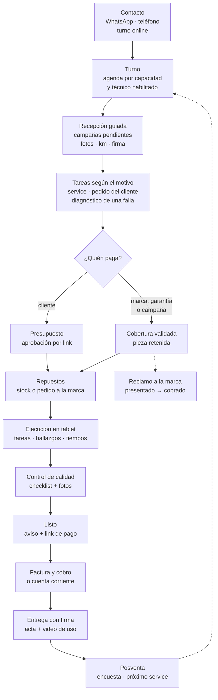
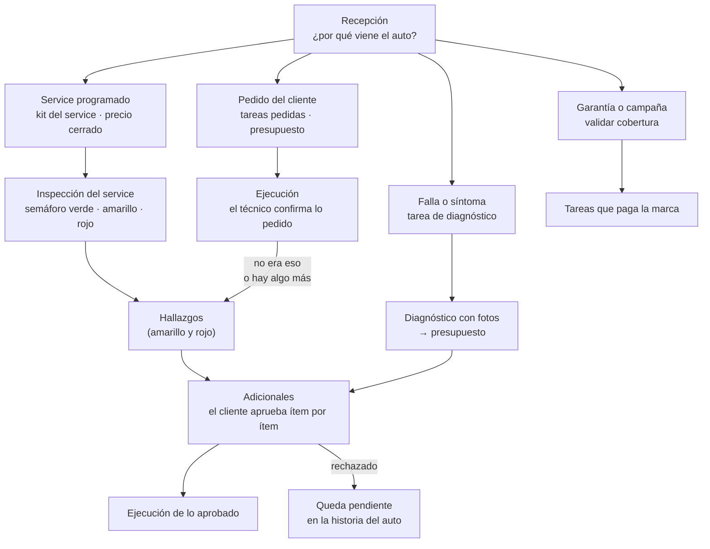
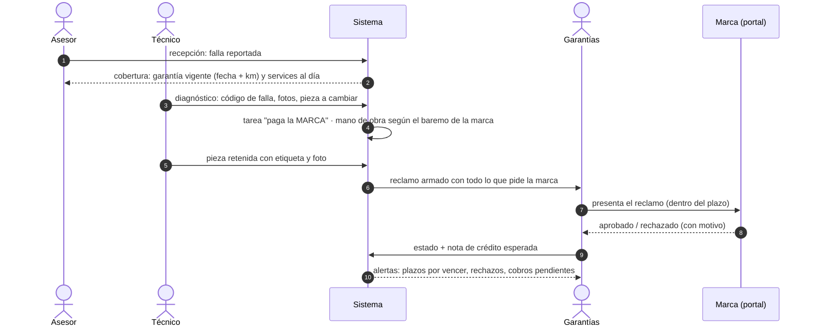

# Flujos de usuario

Inventario de los flujos que **ya tenemos** y de los que **proponemos**, pensado para lo que es el negocio: un **taller de posventa oficial de varias marcas** (service, reparaciones, garantías, campañas, repuestos y accesorios), que además trabaja con concesionarias.

**Cómo leer el estado de cada flujo:**
- **Modelo ✓**: la base de datos lo soporta y está probado ([`pruebas_schema.sql`](pruebas_schema.sql)).
- **Pantalla ✓**: tiene propuesta visual ([`propuestas-visuales/`](propuestas-visuales/)).
- **Diseño**: está descripto en los documentos, sin modelo.

---

## 1. Quién usa el sistema

| Actor | Qué hace | Hoy en el modelo |
|---|---|---|
| **Cliente** (particular, empresa o flota) | Pide turno, aprueba trabajos, retira y firma | Sí |
| **Asesor de servicio** | Atiende, recibe el auto, presupuesta, entrega | Sí, como rol `VENDEDOR` (conviene renombrarlo) |
| **Jefe de taller / coordinador** | Agenda, asigna, controla calidad | Sí |
| **Técnico** | Diagnostica, ejecuta, pide repuestos, saca fotos | Sí |
| **Repuestos / pañol** | Entrega repuestos, pide a las marcas, recibe mercadería | **No** (rol a sumar) |
| **Garantías** | Arma y sigue los reclamos a cada marca | **No** (rol a sumar) |
| **Administración** | Factura, cobra, aprueba ajustes y compras | Sí |
| **Responsable de cada marca** | Aprueba listas de precios (y campañas) | Sí |
| **Gerente** | Mira indicadores y rentabilidad | Parcial |
| **Concesionaria cliente** (externo) | Manda autos para preparación del 0 km y accesorios | **No** |
| **Marca / terminal** (externo) | Paga garantías y campañas, pide indicadores | **No** |
| **Agentes de IA** | Proponen; una persona aprueba | Sí |

---

## 2. El viaje completo del auto

El modelo actual cubre bien el tramo central: turno, ejecución, entrega y factura. Faltan sobre todo los extremos (cómo entra el auto y qué pasa después) y **todo lo que paga la marca**.

---

## 3. Flujos que ya tenemos

### Operación diaria
| # | Flujo | Quién | Estado | Lo que falta para posventa |
|---|---|---|---|---|
| F1 | **Alta de orden** (manual: mostrador, teléfono, WhatsApp) | Asesor | Modelo ✓ · Pantalla ✓ | Tipo de trabajo y quién paga |
| F2 | **Agendar turno** (sin superposiciones, el estado se actualiza solo) | Jefe de taller | Modelo ✓ · Pantalla ✓ | Técnicos habilitados por marca |
| F3 | **Recepción del auto** (km y daños previos) | Asesor | Modelo ✓ (parcial) | Recorrido guiado, chequeo de campañas, firma de recepción |
| F4 | **Ejecución en la tablet** (iniciar, tareas, fotos, pausar, terminar) | Técnico | Modelo ✓ · Pantalla ✓ | Pedido de repuestos, tiempos por tarea |
| F5 | **Cambio en la marcha**: hallazgo → tarea adicional → aprobación del cliente → se hace o queda rechazado | Técnico, asesor, cliente | Modelo ✓ · Pantalla ✓ (historia) | El link de aprobación para el cliente |
| F6 | **Control de calidad** (si se rechaza, la orden se reabre) | Jefe de taller | Modelo ✓ (parcial) | Checklist y fotos |
| F7 | **Entrega con firma** (kiosco, acta inmutable, PDF por WhatsApp) | Asesor, cliente | Modelo ✓ · Pantalla ✓ | — |
| F8 | **Facturación manual asistida** (borrador → ARCA → CAE → emitida; nota de crédito) | Administración | Modelo ✓ · Pantalla ✓ | Factura a la marca o a la concesionaria; cuenta corriente |
| F9 | **Cancelar o reprogramar** una orden | Asesor, jefe de taller | Modelo ✓ | — |

### Stock, precios e historia
| # | Flujo | Estado |
|---|---|---|
| F10 | **Stock**: inventario inicial, ingreso con remito, consumo por tarea, ajuste aprobado por otra persona | Modelo ✓ |
| F11 | **Lista de precios de una marca**: Excel → revisión → aprueba el responsable | Modelo ✓ · Pantalla ✓ |
| F12 | **Consultar la historia clínica** del auto | Modelo ✓ · Pantalla ✓ |
| F13 | **Cambio de titular** (la historia sigue con el auto) | Modelo ✓ |

### Seguridad y emergencia
| # | Flujo | Estado |
|---|---|---|
| F14 | **Ingreso**: passkey, PIN en la tablet, código de emergencia | Modelo ✓ · Pantalla ✓ |
| F15 | **Alta y baja de usuarios**, cambio de rol, revocar una tablet | Modelo ✓ |
| F16 | **Recuperación de cuenta** (otro admin, en persona) | Diseño |
| F17 | **Plan de emergencia** por niveles y **carga diferida desde papel** | Modelo ✓ · Diseño |

### Etapa 2 (diseñados)
| # | Flujo | Estado |
|---|---|---|
| F18 | **WhatsApp**: el agente arma el borrador y la respuesta; el asesor aprueba | Modelo ✓ (propuestas) · Pantalla ✓ |
| F19 | **Reposición nocturna**: el agente propone la compra; Administración aprueba | Modelo ✓ (propuestas) · Pantalla ✓ |

También están diseñados la recepción de mercadería con el remito leído por un agente, el asistente de agenda, la facturación automática y los avisos automáticos al cliente.

---

## 4. Flujos que proponemos

### Prioridad alta: el corazón de una posventa oficial

#### P1. Recepción guiada (check-in)
**Quién:** asesor, con tablet, junto al cliente y al auto.
1. **Busca el auto** por patente o VIN. Si es nuevo, lo da de alta.
2. **El sistema avisa solo:**
   - **campañas o recalls pendientes** de la marca;
   - **garantía vigente** (por fecha y km);
   - **services al día** según la historia;
   - **recomendaciones que quedaron pendientes** en visitas anteriores.
3. **Recorrido guiado** alrededor del auto: fotos de cada lado, daños marcados sobre un dibujo, km y combustible.
4. **Motivo de la visita** con las palabras del cliente ("hace ruido al frenar"). Si es un service, se agrega el **kit del service** de ese modelo.
5. **El cliente firma la recepción** y recibe el comprobante por WhatsApp.
6. La orden queda **confirmada y agendada**, y el auto lleva una etiqueta con QR que abre su orden.

**Por qué:** es donde se protege al taller (daños previos), donde se detectan las campañas (trabajo que paga la marca) y donde se ofrecen los pendientes.

#### P2. Del motivo de ingreso a las tareas
**Quién:** asesor, técnico y cliente.

No toda visita empieza con un diagnóstico. En la recepción, el asesor anota **por qué viene el auto**, y cada motivo arma sus tareas de una forma distinta. **Una misma visita puede combinar varios motivos**: por ejemplo, el service de los 20.000 km, un ruido al frenar y una campaña que el sistema detectó al ingresar.

| Motivo de ingreso | Ejemplo | Cómo se arman las tareas | ¿Diagnóstico? | Precio |
|---|---|---|---|---|
| **Service programado** | "El service de los 20.000 km" | El sistema propone el **kit del service** de esa marca, modelo y kilometraje: tareas, repuestos y tiempo | No | **Cerrado**, conocido antes de empezar |
| **Pedido concreto del cliente** | "Cambiar las pastillas", "poner una alarma" | El asesor agrega lo pedido (o su kit) | No, pero el técnico **confirma** al empezar | Presupuesto antes de empezar |
| **Falla o síntoma** | "Hace ruido al frenar" | Empieza con una **tarea de diagnóstico** | Sí | Se presupuesta después del diagnóstico |
| **Garantía o campaña** | Falla cubierta; recall de la marca | Diagnóstico para validar la cobertura, o el procedimiento que fija la marca para la campaña | Según el caso | Lo paga la marca (P3, P4) |

**Tres reglas valen para todos los caminos:**
1. **Cada service incluye una inspección.** Es un checklist de puntos (frenos, neumáticos, batería, luces, fluidos, etc.) que el técnico marca en **verde, amarillo o rojo**, con foto. Lo amarillo y lo rojo se convierte en recomendaciones. **Ahí nace la mayor parte del trabajo adicional:** según J.D. Power, el cliente aprueba lo recomendado el 51% de las veces cuando ve foto o video, y el 24% cuando no la ve (ver [`IDEAS-MERCADO.md`](IDEAS-MERCADO.md)).
2. **Un pedido concreto se confirma al empezar.** Si el cliente pidió pastillas y el técnico ve que también están gastados los discos, o que el ruido viene de otro lado, lo carga como **hallazgo**. Si lo pedido no hacía falta, la tarea se **cancela con ese motivo**. Decirle al cliente "no hacía falta" genera confianza.
3. **Lo adicional siempre pasa por el cliente**:
   - cada ítem se marca como **necesario, recomendado u opcional**;
   - el cliente aprueba o rechaza **ítem por ítem** desde un **link de WhatsApp**, con foto;
   - lo aprobado se ejecuta y sus repuestos se reservan o se piden;
   - lo rechazado queda **pendiente en la historia clínica** para la próxima visita.

**Ya existe en el modelo:**
- tareas con origen (hallazgo o pedido del cliente);
- aprobación del cliente obligatoria para lo adicional con costo;
- cancelación con motivo;
- hallazgos con severidad (**INFO, ATENCION, URGENTE**, que coinciden con el semáforo verde, amarillo, rojo).

**Falta:**
- el **motivo de ingreso** y el **tipo de cada tarea**;
- los **kits de service por marca, modelo y km**, con precio cerrado;
- el **checklist de inspección**;
- el **presupuesto con vencimiento** y el link.

#### P3. Garantía de fábrica
**Quién:** asesor, técnico y responsable de garantías.

- **Cobertura:** el sistema la valida con la historia clínica (fecha, km, services hechos en la red).
- **Pieza retenida:** se guarda con etiqueta hasta que la marca la libera.
- **Si la marca rechaza:** se corrige y se vuelve a presentar, o se le cobra al cliente (con su aprobación) o queda como costo interno, siempre con motivo.
- **Indicadores:** reclamos presentados en plazo, tasa de rechazo, días hasta el cobro y monto pendiente por marca.

#### P4. Campañas y recalls
**Quién:** responsable de la marca, asesor y clientes.
1. La marca manda la **lista de VIN afectados**. Se carga y la aprueba el responsable, como las listas de precios.
2. **Al ingresar cualquier auto afectado, el sistema avisa** (P1).
3. **Contacto activo:** WhatsApp a los clientes con autos afectados, con link para sacar turno.
4. La tarea de la campaña la **paga la marca**, y se arma su reclamo (P3).
5. **Avance por campaña:** autos afectados, contactados, hechos y pendientes.

#### P5. Pedido de repuestos desde el box
**Quién:** técnico, pañol y asesor.
1. El técnico **pide el repuesto desde la tablet**, desde la tarea.
2. **Si hay stock:** el pañol lo entrega y queda el consumo registrado contra la tarea.
3. **Si no hay:** se arma el **pedido a la marca** (urgente o de stock), la orden pasa a **"esperando repuesto"** y se le avisa al cliente.
4. **Cuando llega:** se registra el ingreso y se avisa al asesor y al jefe de taller, que reagenda.
5. **Sobrante:** se devuelve al stock contra la misma tarea.
6. **El día anterior a cada turno,** el pañol prepara los repuestos de los trabajos agendados.

#### P6. Cobro y retiro
**Quién:** Administración, asesor y cliente.
1. Control de calidad aprobado → **aviso de "listo"** con el detalle y un **link de pago**.
2. **Factura** según quién paga cada tarea:
   - al cliente;
   - a la **marca** (garantía o campaña);
   - a la **concesionaria** o empresa (**cuenta corriente**);
   - o sin factura (interno).
3. **Retiro:** firma de entrega, video corto de uso si corresponde y comprobante por WhatsApp.

#### P7. Trabajos de concesionarias (B2B)
**Quién:** concesionaria cliente, asesor y Administración. Aplica si el taller recibe autos de concesionarias de las marcas.
1. La concesionaria carga **los 0 km a preparar** (preparación del 0 km, accesorios prometidos en la venta) **con fecha de entrega**. Puede hacerlo desde un acceso propio o por un formulario.
2. Cada auto entra como orden con **pagador = concesionaria**.
3. **Tablero por concesionaria:** pendientes, en curso, listos y alertas de entregas en riesgo.
4. **Avisos a la concesionaria** cuando el auto está listo.
5. **Facturación agrupada** a fin de mes, en cuenta corriente.

### Prioridad media: retención y experiencia (etapa 2)

| # | Flujo | Pasos clave |
|---|---|---|
| P8 | **Service programado** | El plan de mantenimiento por marca y modelo calcula el próximo service desde la historia → recordatorio por WhatsApp → turno → orden ya armada con el kit del service |
| P9 | **Turno online** | El cliente elige marca, modelo y servicio → horarios según la capacidad real y los técnicos habilitados → confirmación → recordatorio 24 h antes → recepción rápida |
| P10 | **Seguimiento del auto por link** | Recibido → En diagnóstico → **Esperando tu aprobación** → **Esperando repuesto** → En reparación → Control de calidad → Listo. Con fotos y videos del trabajo |
| P11 | **Después de la entrega** | Encuesta a las 48–72 h → si la nota es baja, alerta al jefe de taller → llamada → link de reseña en Google |
| P12 | **Retrabajo** | El auto vuelve antes de 30 días por lo mismo → orden de retrabajo vinculada a la original, sin cargo, con causa y técnico |
| P13 | **Pendientes no aceptados** | Lo que el cliente rechazó se le recuerda una sola vez (con su consentimiento) y se ofrece en la próxima recepción |

### Prioridad media: gestión (etapa 2)

| # | Flujo | Pasos clave |
|---|---|---|
| P14 | **Técnicos y habilitaciones** | Alta de habilitaciones por marca y tecnología (alta tensión en eléctricos e híbridos), con vencimiento → la agenda sólo asigna técnicos habilitados |
| P15 | **Fichaje por tarea y productividad** | Inicio, pausa (con motivo) y fin por tarea → eficiencia contra el baremo → tablero por técnico |
| P16 | **Cierre del día y del mes** | Órdenes abiertas, consumos sin facturar, garantías por vencer, caja, ritmo del mes contra el objetivo, margen por orden |
| P17 | **Reportes a cada marca** | Indicadores y encuestas que pide cada terminal, listos para enviar |
| P18 | **Compra a la marca** | Pedido (urgente o de stock) → seguimiento → recepción → diferencias → reclamo al proveedor |

---

## 5. Lo que estos flujos le piden al modelo

Hay que sumar, con sus reglas y pruebas, como hicimos con lo demás:
- **Motivo de ingreso de la visita** y **tipo y pagador de cada tarea**: service, mantenimiento pedido, diagnóstico, reparación, garantía, campaña, accesorio, preparación del 0 km; paga el cliente, la marca, la concesionaria o es interno. Es la base de P2, P3, P4, P6 y P7.
- **Kits de service** por marca, modelo y km, con precio cerrado, y **checklist de inspección** con semáforo (P2).
- **Reclamo de garantía** con sus estados, plazos y pieza retenida (P3).
- **Campañas:** VIN afectados por marca, con responsable y avance (P4).
- **Pedido de repuestos** desde la tarea y estado **"esperando repuesto"** en la orden (P5).
- **Presupuesto** con vencimiento y aprobación por ítem (P2).
- **Cuenta corriente** para concesionarias, empresas y flotas (P6, P7).
- **Habilitaciones de técnicos** por marca y tecnología (P14).
- **Plan de mantenimiento** por marca y modelo (P8).
- **Roles nuevos:** Repuestos, Garantías y, si accede, Concesionaria cliente. El rol `VENDEDOR` pasa a llamarse **Asesor de servicio**.

## 6. Orden sugerido

1. **Etapa 1:**
   - P1 recepción guiada;
   - P2 del motivo de ingreso a las tareas (service, pedido, diagnóstico);
   - P3 garantía de fábrica;
   - P5 repuestos desde el box;
   - P6 cobro y retiro con cuenta corriente;
   - P7 trabajos de concesionarias, si aplica;
   - P4 campañas, en su versión simple: el aviso al ingresar.
2. **Etapa 2:**
   - P8 a P13 (retención y experiencia);
   - P14 a P18 (gestión);
   - P4 completo, con contacto activo.

## 7. Preguntas que definen los flujos

1. ¿Qué marcas atienden, y cómo presenta cada una las garantías (portal propio, sistema obligatorio, email)?
2. ¿Hay alguien dedicado a garantías y alguien a cargo del pañol de repuestos?
3. ¿El **diagnóstico se cobra**? ¿Se descuenta si después el cliente aprueba la reparación?
4. ¿Trabajan para concesionarias? ¿Con cuenta corriente?
5. ¿Cómo llegan hoy las campañas de las marcas?
6. ¿Atienden eléctricos o híbridos?
7. ¿Prestan auto de cortesía? Si es así, sería otro flujo (reserva, entrega y devolución con fotos).
