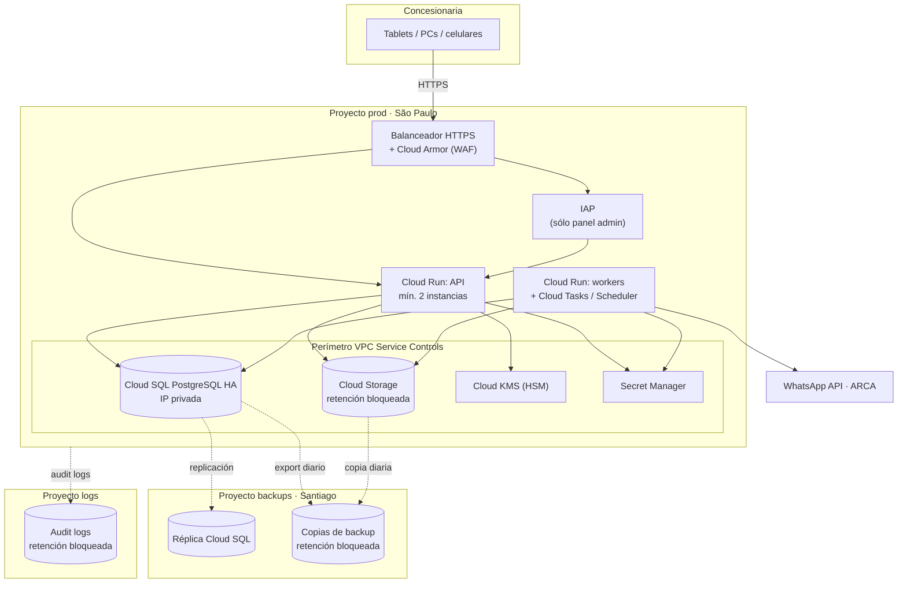

# Infraestructura en Google Cloud (GCP)

## Respuesta corta

**Sí, el sistema corre en GCP, y puede ser muy seguro.**

- **Lo que hace Google:** cifra todo en reposo por defecto, opera centros de datos con certificaciones ISO 27001/27017/27018 y SOC 2, y ofrece las herramientas que pide [SEGURIDAD.md](SEGURIDAD.md): gestión de claves (KMS), gestor de secretos, WAF, auditoría.
- **Lo que hacemos nosotros:** la seguridad en la nube es **compartida**. Google protege la infraestructura, pero **la configuración, los permisos y el código son responsabilidad nuestra**.

La mayoría de los incidentes en la nube no son "hackeos a Google". Son **errores de configuración**: un bucket público, una clave de cuenta de servicio subida a un repositorio, alguien con más permisos de los necesarios. Por eso este documento define **la configuración segura** y la fija con **políticas de organización que impiden esos errores**, aunque alguien se equivoque.

**Verificado:** el esquema ([`schema.sql`](schema.sql)) y sus 73 pruebas corren con un usuario **sin superusuario**, igual que en Cloud SQL. Usa sólo funciones estándar y la extensión `btree_gist`, que Cloud SQL soporta.

---

## 1. Región

| | Región | Para qué |
|---|---|---|
| **Principal** | **São Paulo** (`southamerica-east1`) | Todo el sistema. ~30–40 ms desde Buenos Aires |
| **Respaldo** | **Santiago** (`southamerica-west1`) | Réplica de la base y copias de los backups, por si se cae la región entera |

GCP no tiene región en Argentina, así que los datos quedan en Brasil y en Chile. Ver [§9 Legal](#9-legal-validar-con-un-abogado).

---

## 2. Cada pieza del diseño en GCP

| Pieza del diseño | Servicio de GCP | Configuración clave |
|---|---|---|
| API sin estado, ≥ 2 instancias | **Cloud Run** | Regional (reparte entre zonas solo), **mínimo 2 instancias** (sin demora de arranque), sólo recibe tráfico del balanceador |
| Workers (PDF, WhatsApp, avisos) y cola | **Cloud Run** + **Cloud Tasks** | Reintentos con backoff; cada worker con su propia cuenta de servicio |
| Agenda de las 7:00 por email | **Cloud Scheduler** | Dispara un worker |
| PostgreSQL en alta disponibilidad | **Cloud SQL para PostgreSQL**, configuración **HA** | Primario + standby en otra zona con failover automático, **sólo IP privada**, SSL obligatorio, backups + recuperación a un punto en el tiempo (PITR), **réplica en Santiago** |
| Fotos, firmas, actas y facturas | **Cloud Storage** | Acceso público bloqueado, versionado, **retención bloqueada (Bucket Lock)** para actas y facturas, links firmados de 5 min |
| Cifrado de DNI/teléfono/email (KMS) | **Cloud KMS** | Clave de cifrado con nivel **HSM**; clave **HMAC** dentro del KMS (nunca sale); ninguna persona con permiso de descifrar |
| Secretos (WhatsApp, certificado de ARCA) | **Secret Manager** | Cada secreto accesible sólo por el servicio que lo usa |
| WAF y límite de intentos | **Cloud Armor** en el balanceador HTTPS | Reglas OWASP, límite por IP, certificado TLS administrado por Google |
| Panel de administración sólo para equipos de la empresa | **Identity-Aware Proxy (IAP)** | Antes de ver el login del sistema, hay que pasar por una cuenta de la empresa con llave de seguridad (opcional: chequeo del equipo con Chrome Enterprise Premium) |
| Monitoreo y alertas | **Cloud Monitoring + Logging** | Chequeos de disponibilidad desde afuera, alertas de errores y de eventos de seguridad |
| Auditoría | **Cloud Audit Logs** | Copia a un bucket con retención bloqueada en otro proyecto |
| Imágenes de la aplicación | **Artifact Registry** | Escaneo de vulnerabilidades |

---

## 3. Diagrama

---

## 4. Organización y proyectos

Se crea una **organización** de GCP con el dominio de la empresa (Cloud Identity, que tiene versión gratuita, o Google Workspace si ya lo usan). Debajo van **proyectos separados**:

| Proyecto | Qué tiene | Por qué separado |
|---|---|---|
| **prod** | El sistema real | — |
| **staging** | Una copia para probar, **con datos ficticios** (nunca datos reales de clientes) | Probar cambios sin riesgo |
| **backups** (Santiago) | Réplica de la base y copias de backup | **Si alguien compromete prod, no puede borrar los backups**: son otros permisos y otras personas |
| **logs** | Registros de auditoría de todos los proyectos | Quien ataca no puede borrar sus rastros |

---

## 5. Configuración segura: lo que hace la diferencia

### Personas que administran GCP
- **Llave de seguridad física obligatoria** para entrar a la consola. Se fuerza desde Cloud Identity / Workspace.
- **Al menos 2 personas** con acceso de administración. **Ninguna usa permisos de dueño en el día a día**: se eleva el acceso sólo cuando hace falta, por un tiempo limitado y con registro.
- Sólo **cuentas de la empresa**, nunca un Gmail personal. Los permisos se dan a **grupos**, no a personas sueltas.

### Cuentas de servicio (las "identidades" de cada programa)
- **Una por servicio**, con permisos mínimos. La API no tiene los permisos del worker de facturación, y viceversa.
- **Sin claves descargables**: Cloud Run usa su identidad sin archivos de claves.
- El despliegue desde GitHub se hace con **Workload Identity Federation**: no hay ninguna clave de GCP guardada en GitHub.
- **No usar la cuenta de servicio por defecto** de GCP, que viene con permisos de editor de todo el proyecto.

### Barandas: políticas de organización
Impiden los errores típicos **aunque alguien lo intente**:

| Política | Qué impide |
|---|---|
| `iam.disableServiceAccountKeyCreation` | Crear claves de cuentas de servicio (la filtración más común) |
| `iam.automaticIamGrantsForDefaultServiceAccounts` | Que las cuentas por defecto nazcan con permisos de editor |
| `iam.allowedPolicyMemberDomains` | Dar acceso a cuentas de fuera de la empresa |
| `storage.publicAccessPrevention` | Que un bucket (fotos, actas, facturas) quede público |
| `storage.uniformBucketLevelAccess` | Permisos sueltos por archivo, difíciles de auditar |
| `sql.restrictPublicIp` | Que la base de datos tenga IP pública |
| `gcp.resourceLocations` | Crear recursos fuera de São Paulo / Santiago |

### Red
- **Cloud SQL sólo con IP privada.** La API llega por la red interna (VPC); desde internet no existe.
- **Cloud Run sólo acepta tráfico del balanceador**, que tiene Cloud Armor adelante.
- **VPC Service Controls**: un perímetro alrededor de la base, el storage, el KMS y los secretos. Aunque alguien robe una credencial válida, **no puede sacar los datos fuera del perímetro**.

### Claves y datos
- **Cloud KMS** con separación de funciones: quien **administra** las claves no puede **usarlas**, y **ninguna persona** tiene permiso de descifrar. Sólo la cuenta de servicio de la API puede.
- La **clave HMAC vive dentro del KMS**: la API le pide la huella del teléfono y la clave nunca sale.
- Rotación anual de la clave de cifrado.
- **Bucket Lock** en actas y facturas: ni un administrador puede borrarlas antes del plazo. **Ojo: una vez bloqueado, el plazo no se puede acortar**, así que se define antes con el contador y el abogado.

### Auditoría y detección
- **Cloud Audit Logs**: los registros de "acceso a datos" de KMS, Secret Manager, Cloud SQL y Storage **vienen apagados**. Hay que **activarlos** para saber quién descifró o leyó qué.
- Todo se copia al **proyecto logs**, con retención bloqueada.
- **Security Command Center** (nivel estándar) revisa la configuración y avisa si algo queda mal, por ejemplo un bucket público.
- **Alertas** (Cloud Monitoring): sistema caído, aumento de errores, eventos de seguridad del sistema (intentos fallidos, ingreso de admin desde equipo nuevo, uso de la cuenta rompe-vidrio).
- **Presupuesto con alertas de gasto**: un salto de costos inesperado suele ser la primera señal de una cuenta comprometida, por ejemplo usada para minar criptomonedas.

### Software
- **Toda la infraestructura como código (Terraform)**, revisada antes de aplicarse. **Nadie crea ni cambia cosas a mano en la consola de prod**: así la configuración segura no se "desarma" con el tiempo.
- Imágenes escaneadas en Artifact Registry. Sólo se despliega lo que pasó por el pipeline.

---

## 6. Alta disponibilidad en GCP

| Falla | Qué pasa |
|---|---|
| Se cae una instancia de la API | Cloud Run levanta otra; la segunda instancia atiende mientras tanto |
| Se cae una zona de São Paulo | Cloud Run ya está repartido en varias zonas; Cloud SQL HA pasa al standby automáticamente (minutos) |
| Se cae toda la región de São Paulo | Se **promueve la réplica de Santiago** y se despliega la API allá (procedimiento escrito y probado con Terraform). Mientras tanto rige el **nivel 4 del [plan de emergencia](PLAN-B.md)** |
| Borrado o corrupción de datos | Recuperación a un punto en el tiempo de Cloud SQL, o las copias diarias en Santiago |

Los niveles de servicio que publica Google para Cloud Run y Cloud SQL en HA son compatibles con el objetivo del diseño (≥ 99,9 %, ver README §8). Hay que confirmar los valores vigentes en la página de SLA de cada servicio.

---

## 7. Costos

- Lo más caro suele ser **Cloud SQL en HA**, porque se paga la instancia y su standby, más la réplica en Santiago.
- Cloud Run cobra por uso y, con el volumen de un taller, es bajo, aunque las 2 instancias mínimas tienen un costo fijo.
- Staging puede ser mucho más chico que prod.
- Estimar con la **calculadora de precios de Google Cloud** y crear el **presupuesto con alertas** desde el día 1.

---

## 8. Checklist GCP antes de producción

- [ ] Organización creada; proyectos prod / staging / backups / logs
- [ ] Llave de seguridad obligatoria para todos los que administran GCP; 2 administradores
- [ ] Políticas de organización de la tabla del §5 aplicadas
- [ ] Cloud SQL HA con IP privada, SSL obligatorio, PITR y réplica en Santiago
- [ ] Buckets privados; Bucket Lock en actas y facturas **con plazo aprobado por legal**
- [ ] KMS: claves de cifrado y HMAC separadas; nadie humano con permiso de descifrar
- [ ] VPC Service Controls activo alrededor de SQL, Storage, KMS y Secret Manager
- [ ] Audit logs de acceso a datos activados y copiados al proyecto logs
- [ ] Cloud Armor con reglas OWASP y límites por IP
- [ ] IAP delante del panel de administración
- [ ] Toda la infraestructura en Terraform; nada creado a mano en prod
- [ ] Despliegue desde GitHub con Workload Identity Federation (sin claves)
- [ ] Presupuesto y alertas de gasto
- [ ] **Simulacro**: restaurar la base desde backup y promover la réplica de Santiago en staging

---

## 9. Legal (validar con un abogado)

- Guardar datos de clientes en **Brasil o Chile** es una **transferencia internacional de datos personales** según la Ley 25.326 (art. 12). Se puede hacer, pero necesita una base legal: por ejemplo, **cláusulas contractuales** con el proveedor según los modelos de la AAIP, o el **consentimiento** del titular.
- Google ofrece un anexo de tratamiento de datos para Google Cloud. El abogado tiene que verificar que cubra lo que pide la normativa argentina, o qué hace falta agregar.
- Esto **no es exclusivo de GCP**: AWS y Azure tampoco tienen región en Argentina. Mismo análisis para cualquier nube.
