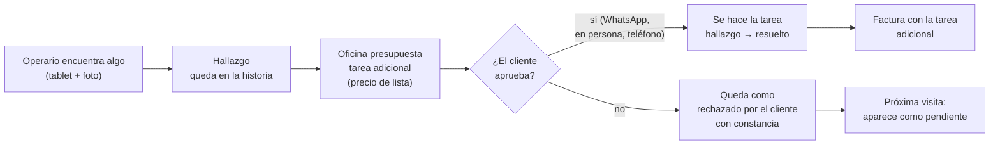
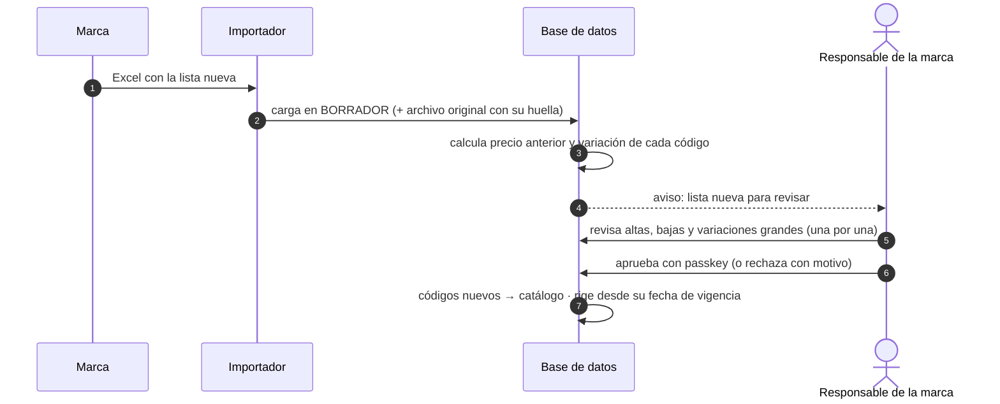

# El proceso: historia clínica del auto, unidad de trabajo, stock y listas de precios

Este documento responde cuatro preguntas del relevamiento. Todo lo que dice "la base lo garantiza" está implementado en [`schema.sql`](schema.sql) y probado en [`pruebas_schema.sql`](pruebas_schema.sql).

---

## 1. La historia clínica del auto

La analogía es exacta: **cada auto tiene su historia clínica**, y el sistema la arma sola a medida que se trabaja.

| En una clínica | En el taller | En el sistema |
|---|---|---|
| Paciente | **El auto** (patente o VIN) | `vehiculo` |
| Consulta o internación | **Visita**: entra, se trabaja, se entrega | `orden` (OT), con el **kilometraje de ingreso** |
| Estado al ingresar | **Daños previos**: rayones, golpes, faltantes | `hallazgo` tipo `DANO_PREVIO`, con foto |
| Diagnóstico y hallazgos | **Lo que se encuentra** trabajando: fallas, recomendaciones | `hallazgo` (`FALLA`, `RECOMENDACION`, `OBSERVACION`) |
| Prácticas realizadas | **Tareas** hechas: quién, cuándo, con qué | `orden_item` |
| Consentimiento informado | **El cliente aprueba** un trabajo adicional | aprobación registrada en la tarea (canal y referencia) |
| Implantes y prótesis | **Lo que quedó instalado**, con número de serie y garantía | `componente_instalado` |
| Alta | **Entrega** con acta firmada | `acta_entrega` |
| Cambio de obra social o de médico | **Cambio de dueño** | `vehiculo_titular` |

### Cómo se ve
Una línea de tiempo por auto (vista `vista_historia_vehiculo`) que junta visitas, tareas, hallazgos, componentes y entregas. Ver la propuesta visual [`11-historia-vehiculo.html`](propuestas-visuales/11-historia-vehiculo.html).

### Reglas que garantiza la base
- **La historia es del auto, no del dueño.** Si el auto se vende, la historia sigue. La línea de tiempo **no incluye datos del dueño**: el nuevo dueño puede ver qué se le hizo al auto sin ver quién era el anterior (probado).
- **Lo que se encontró no se borra ni se reescribe.** Si el cliente no quiere arreglar algo, queda como *"rechazado por el cliente"* y hay que dejar constancia escrita. Protege al taller ("se le informó") y en la próxima visita aparece como pendiente (probado).
- **Un número de serie no puede estar instalado en dos autos a la vez**, y un componente sólo se registra a partir de una tarea hecha en ese mismo auto (probado).
- **Los componentes no se borran**: se dan de baja por retiro o reemplazo, y queda cuál lo reemplazó.
- **Cada cambio de dueño queda registrado** (probado).

### Recomendado: acta de recepción
Al recibir el auto se anotan el kilometraje y los daños previos (con fotos), y el cliente **firma la recepción** con el mismo mecanismo que la entrega. Es lo que evita el *"esto me lo rayaron ustedes"*. Los datos ya tienen dónde guardarse; la firma de recepción se suma cuando lo confirmen.

---

## 2. La unidad de trabajo

Hay **dos niveles**, como en una clínica la internación y cada práctica:

| | **Orden de trabajo (OT)** = la visita | **Tarea** = lo que se ejecuta |
|---|---|---|
| Qué es | Un auto que entra, se trabaja y se entrega | Una instalación o servicio concreto: "Alarma X-200", "Polarizado 70 %" |
| Agrupa | Cliente, vehículo, km, turno, hallazgos, **acta de entrega**, **factura** | Producto, cantidad, **precio** (de qué lista salió), quién la hizo y cuándo, qué consumió del stock |
| Estados | Borrador → Confirmada → Agendada → En curso → Terminada → Entregada | Pendiente → Hecha, o Cancelada (con motivo) |
| Para qué sirve | Gestionar al cliente: avisar, cobrar, que firme | Medir el trabajo: tiempos, productividad, consumo, garantías |

**Recomendación:** la **tarea** es la unidad de medida (tiempos, consumo, margen, garantía) y la **orden** es la unidad de gestión con el cliente (turno, firma, factura). Una visita puede tener varias tareas, y cada una puede hacerla un operario distinto.

---

## 3. Cambios en la marcha

Pasa todo el tiempo: el operario abre el tablero para instalar la alarma y encuentra que la batería está baja. El proceso:

**Reglas que garantiza la base** (todas probadas):

| Regla | Por qué |
|---|---|
| Mientras la orden es **borrador**, se edita libremente | Se está armando con el cliente |
| Ya **confirmada**, una tarea nueva tiene que decir **de dónde sale** (hallazgo o pedido del cliente) y **por qué** | Que no aparezcan trabajos sin explicación |
| Un **trabajo adicional con costo no se puede marcar como hecho sin la aprobación del cliente** (canal y referencia, por ejemplo el mensaje de WhatsApp) | Es el "consentimiento informado": no se cobra algo que el cliente no aprobó |
| Lo **pactado** de una tarea (qué, cuánto, a qué precio) **no se edita**: se cancela con motivo y se agrega otra | El precio que se le dijo al cliente no cambia en silencio |
| Una tarea **no se borra**: se cancela, siempre con motivo | Queda la historia de lo que se ofreció |
| La orden **no se puede terminar con tareas pendientes** | Nada queda a medias sin decisión |
| Una orden **terminada no recibe tareas nuevas** (si hace falta, se reabre) | Lo terminado es lo que se entrega y se factura |
| **Cada cambio queda en el historial** de la orden: tarea agregada, aprobada por el cliente, hecha o cancelada, con quién y por qué | Trazabilidad completa |

Si la tarea nueva necesita más tiempo, se extiende o se agrega un turno en la agenda, y la base sigue impidiendo superposiciones.

---

## 4. Stock: cómo se carga y cómo se mueve

El stock **no es un número que alguien edita**: es la **suma de un libro de movimientos** que no se borra, como una cuenta bancaria. Un error se corrige con otro movimiento, nunca borrando.

| Movimiento | Cuándo | Quién | Regla de la base (probada) |
|---|---|---|---|
| **Inventario inicial** | Al arrancar: conteo físico de todo | Administración | **Una sola vez por artículo**; después todo son movimientos |
| **Ingreso** | Llega mercadería del proveedor | Quien recibe | **Siempre con número de remito o factura** |
| **Consumo** | El operario usa algo en una tarea | El operario, desde la tablet | **Siempre contra una tarea** de una orden en curso o terminada |
| **Devolución** | Vuelve algo sin usar | Quien lo devuelve | Contra la tarea de la que salió |
| **Ajuste** | El conteo no coincide (pérdida, rotura, error) | Lo carga uno y **lo aprueba otra persona de Administración** | Con motivo; **nadie puede aprobar su propio ajuste** |

- **La carga de stock**: el inventario inicial y los ingresos se cargan desde el back-office. En la etapa 2, el agente de recepción lee el remito y lo propone (ver [`AGENTES.md`](AGENTES.md)), y **una persona cuenta y confirma**.
- **El stock no bloquea el trabajo**: si un consumo deja el stock en negativo (porque el ingreso todavía no se cargó), no se frena al operario. Se marca como diferencia para revisar.
- **Reservas por agenda, proyección y compras sugeridas** son la parte "inteligente" de la etapa 2 ([`ETAPAS.md`](ETAPAS.md)) y se apoyan en este mismo libro.

> **Propuesta de etapas:** pasar este **stock básico** (inventario inicial, ingresos, consumos y ajustes) **a la etapa 1**, y dejar en la etapa 2 sólo la parte inteligente. Hay dos motivos: los números de serie de la historia clínica salen de acá, y el historial de consumo es lo que después hace inteligente al stock. Cuanto antes se empiece a juntar, mejor.

---

## 5. Listas de precios por marca

Cada marca manda su lista de precios en Excel. El flujo:

### Qué se automatiza y qué no

| Paso | Etapa 1 | Etapa 2 |
|---|---|---|
| Recibir el Excel | Alguien lo sube al sistema | Llega por un **email dedicado** y se carga solo |
| Leer el Excel | Plantilla configurada **por marca** (qué columna es el código, cuál el precio) | Si una marca cambia el formato, un **agente propone cómo leerlo** y el responsable lo confirma |
| Comparar con la lista anterior | Automático | Automático |
| **Aprobar** | **El responsable de la marca** | **El responsable de la marca. Siempre.** |

**"Se puede automatizar, pero el humano siempre es el responsable"** está escrito en la base, no sólo en un procedimiento:

| Regla de la base (todas probadas) | Qué evita |
|---|---|
| Cada marca tiene **un responsable de precios designado**, y **sólo esa persona** aprueba o rechaza sus listas. Ni un vendedor ni el admin pueden | Que la lista la active cualquiera |
| Cambiar al responsable **queda en el registro de seguridad** | Cambios de responsable silenciosos |
| La **variación de cada precio la calcula la base**, no el importador | Que un error o un archivo manipulado **disimule una suba** |
| Las variaciones mayores al umbral de la marca (por defecto **30 %**) se **confirman una por una** antes de poder aprobar | Que una suba de 50 % (o un precio mal cargado) pase inadvertida |
| Una lista aprobada **no se modifica**: si hay un error, se carga una nueva | Que cambien precios ya vigentes sin rastro |
| Rechazar una lista **exige decir por qué** | Rechazos sin explicación para la marca |
| Cada lista guarda el **Excel original con su huella digital** | Saber exactamente qué mandó la marca |
| Los **códigos nuevos** se dan de alta en el catálogo **al aprobar**, no antes | Artículos con precios sin revisar |
| Cada tarea guarda **de qué lista salió su precio** | Poder explicar cualquier precio cobrado |

Además:
- **Las órdenes ya pactadas no cambian de precio** cuando llega una lista nueva: lo que se le dijo al cliente se respeta.
- **Vigencia por fecha**: una lista puede cargarse y aprobarse antes de que rija. El sistema usa siempre la última aprobada cuya fecha ya llegó.
- **Bajas**: los códigos que estaban en la lista anterior y no vienen en la nueva se muestran al responsable, para decidir si se discontinúan.

Ver la propuesta visual [`12-listas-precios.html`](propuestas-visuales/12-listas-precios.html).

---

## 6. Preguntas para cerrar

1. **Listas de precios:** ¿vienen en pesos o en dólares? ¿Con o sin IVA? ¿Son precio al público, costo para la concesionaria, o los dos?
2. ¿Cada cuánto llegan? ¿Todas las marcas usan el mismo formato de Excel?
3. ¿Quién es hoy el responsable de revisar los precios de cada marca?
4. **Historia clínica:** ¿qué componentes llevan número de serie y garantía (alarmas, multimedia, cámaras…)? ¿Cuánto dura cada garantía?
5. ¿Quieren el **acta de recepción firmada** al ingresar el auto?
6. ¿Pasamos el **stock básico a la etapa 1**?
