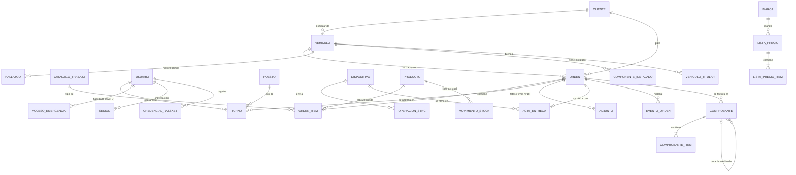
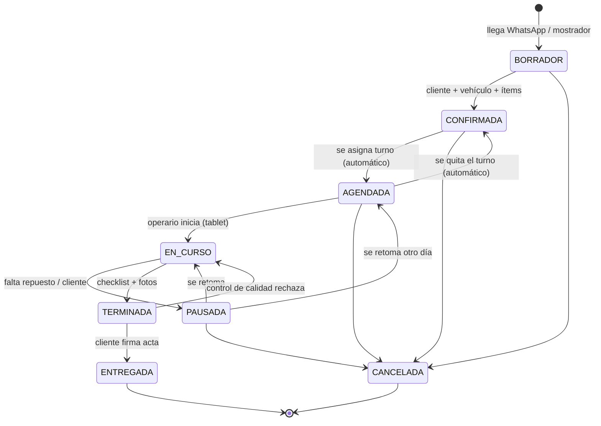
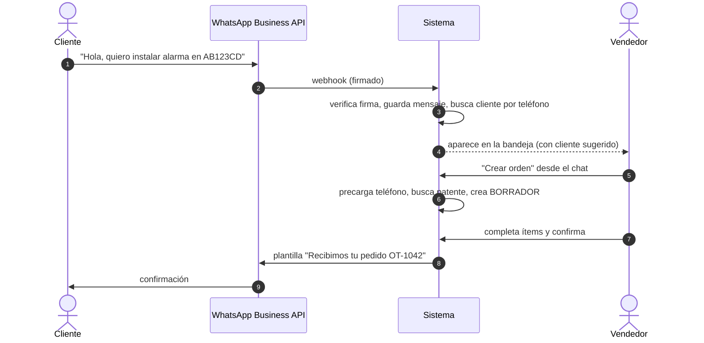
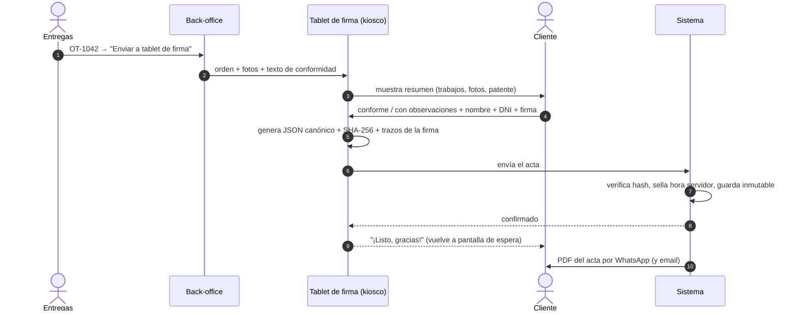
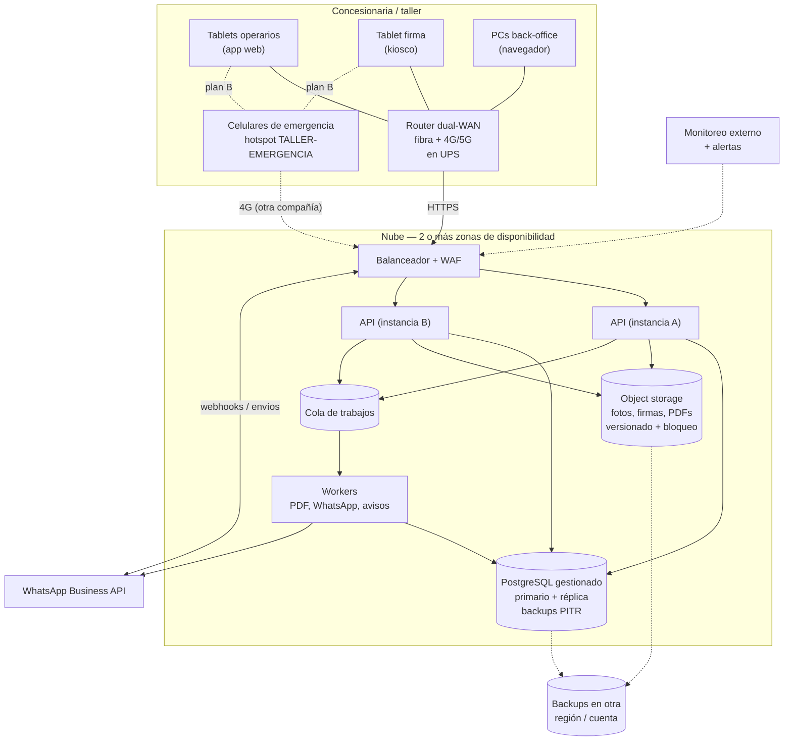

# Sistema de órdenes de instalación para concesionaria

Documento de diseño **v0.2**: lógica de negocio, arquitectura, seguridad, alta disponibilidad, plan de emergencia y etapas.

| Archivo | Qué es |
|---|---|
| `README.md` | Este documento: cómo funciona el sistema y por qué está diseñado así |
| [`propuestas-visuales/`](propuestas-visuales/) | **12 pantallas de diseño** (HTML): ingreso, tablero, agenda, orden, tablets, WhatsApp, stock, facturación, centro de control, historia del auto y listas de precios. Abrir `index.html` |
| [`PROCESO.md`](PROCESO.md) | **Historia clínica del auto**, unidad de trabajo (orden y tareas), cambios en la marcha, carga de stock y **listas de precios por marca** |
| [`ETAPAS.md`](ETAPAS.md) | **Etapa 1** (digitalización, carga manual, facturación manual asistida) y **etapa 2** (WhatsApp, facturación automática, stock inteligente) |
| [`SEGURIDAD.md`](SEGURIDAD.md) | Ingreso ultra seguro (passkeys por rol), datos sensibles cifrados, quién ve qué, recuperación de cuentas |
| [`AGENTES.md`](AGENTES.md) | Agentes de IA (stock, mercadería, WhatsApp, agenda): proponen, una persona aprueba |
| [`INFRA-GCP.md`](INFRA-GCP.md) | Cómo se arma en Google Cloud y la configuración segura (proyectos, políticas, red, claves, auditoría) |
| [`PLAN-B.md`](PLAN-B.md) | Plan de emergencia por niveles (hotspot, celular, papel), para imprimir y tener en el taller |
| [`schema.sql`](schema.sql) | Modelo de datos en PostgreSQL con las reglas de negocio aplicadas en la base |
| [`pruebas_schema.sql`](pruebas_schema.sql) | 123 pruebas que verifican esas reglas (`psql -f schema.sql -f pruebas_schema.sql`) |

---

## 0. Resumen

1. **El cliente pide la instalación** (WhatsApp, teléfono o mostrador) y el vendedor carga la **orden**. En la etapa 2, la orden se arma directamente desde el chat de WhatsApp conectado al sistema. La orden queda asociada a un **cliente** (por teléfono y DNI/CUIT) y a un **vehículo** (por **patente**, o por VIN si es un 0km sin patente).
2. **El coordinador asigna la instalación en un calendario**: arrastra la orden al horario de un operario y un box. El sistema no permite superposiciones. La orden pasa sola a `AGENDADA` y **le llega al operario a la tablet**.
3. **El operario trabaja desde la tablet**: inicia, marca los ítems, saca fotos y cierra.
4. **En la entrega, el cliente firma en una tablet de firma** en modo kiosco. Se guarda un acta inmutable con hash, trazos de la firma, hora y dispositivo, y el cliente recibe el PDF por WhatsApp.
5. **Si falla internet**, hay un **plan de emergencia por niveles**: el router pasa solo a 4G; si no alcanza, los **celulares de la empresa comparten datos a las tablets**; si no, se trabaja **desde el celular**; y como último recurso, **papel**, que se carga después con la hora real. Ver [`PLAN-B.md`](PLAN-B.md).

6. **Se factura desde la orden**: en la etapa 1 el sistema arma la factura y una persona la emite en ARCA (manual asistida); en la etapa 2 es automática. Ver [`ETAPAS.md`](ETAPAS.md).
7. **Agentes de IA en la etapa 2** (stock, mercadería, WhatsApp, agenda): analizan y **proponen**; una persona con el rol que corresponde **aprueba**. Ver [`AGENTES.md`](AGENTES.md).
8. **Seguridad desde el día 1**: admin y facturación entran sólo con **passkey**, los datos personales se guardan **cifrados** y todo ingreso queda registrado. Ver [`SEGURIDAD.md`](SEGURIDAD.md).

**Decisión de arquitectura:** todo en la nube y **tablets online**. La app de la tablet es la misma web del back-office, sin servidores en el local y sin datos guardados en las tablets. Es lo más simple de construir y mantener. A cambio, **la conexión pasa a ser crítica**, y se cubre con redundancia de red y el plan de emergencia.

---

## 1. Actores

| Actor | Qué hace | Dónde |
|---|---|---|
| **Cliente** | Pide la instalación por WhatsApp; firma al retirar el vehículo | Su WhatsApp / tablet de firma |
| **Vendedor / atención** | Responde el WhatsApp, arma y confirma la orden | Back-office web (PC) |
| **Coordinador de taller** | Asigna turnos en el calendario, reprograma y es el **responsable de emergencia** del turno | Back-office web (PC) |
| **Operario** | Recibe sus órdenes, ejecuta, marca ítems, saca fotos y cierra | Tablet de operario |
| **Entregas** | Presenta el acta al cliente en la tablet de firma | Back-office + tablet de firma |
| **Administración** | Emite facturas y notas de crédito | Back-office web (PC de la empresa) |
| **Admin** | Usuarios, tablets, catálogo de trabajos, permisos | Back-office web (PC de la empresa) |

---

## 2. Modelo de datos

### Reglas clave del dominio

- **Patente**: se guarda normalizada (`ab-123 cd` → `AB123CD`), con validación de formato argentino (viejo `ABC123`, Mercosur `AB123CD` y motos) y es **única**. Así cada vehículo tiene su historial de órdenes.
- **0km sin patente**: en una concesionaria pasa seguido. El vehículo se identifica por **VIN** (número de chasis) y la patente se completa después. La regla es "patente **o** VIN, al menos uno".
- **Cliente**: se identifica de forma única por **DNI/CUIT** y se busca por **teléfono** (formato E.164, ej. `+5491155551234`). El teléfono no es único: una familia o empresa puede compartirlo. **DNI, teléfono y email se guardan cifrados**; la búsqueda y el control de duplicados se hacen con una huella (HMAC) sin descifrar ([`SEGURIDAD.md`](SEGURIDAD.md)).
- **Patente ya asociada a otro cliente**: el sistema avisa ("¿cambio de titular?") y no bloquea.
- **Orden mínima para confirmar**: cliente + vehículo + al menos un ítem. Un *borrador* puede existir incompleto, porque nace de un chat donde los datos llegan de a poco.
- **Las órdenes no se borran, se cancelan.** Los turnos tampoco se borran. El acta y el historial son inmutables.
- **Cada auto tiene su historia clínica** (visitas, km, hallazgos, tareas, componentes con serie y garantía, entregas, cambios de dueño). La **orden** es la visita y la **tarea** es la unidad de ejecución. Una orden en curso puede cambiar, pero cada cambio dice de dónde sale y por qué, y lo que tiene costo necesita la aprobación del cliente. Ver [`PROCESO.md`](PROCESO.md).

Todo esto lo hace cumplir la base de datos ([`schema.sql`](schema.sql)), no sólo la aplicación. Un bug en el código no puede dejar datos inconsistentes.

---

## 3. Ciclo de vida de la orden

| Transición | Quién | Condición que verifica la base |
|---|---|---|
| → `CONFIRMADA` | Vendedor | Tiene cliente, vehículo y ≥ 1 ítem |
| → `AGENDADA` | **Automático** al asignar turno | Hay un turno vigente |
| `AGENDADA` → `CONFIRMADA` | **Automático** al quitar el último turno | Queda "para reprogramar" |
| → `EN_CURSO` / `PAUSADA` / `TERMINADA` | Operario (tablet) | Transición válida |
| → `ENTREGADA` | Entregas (tablet de firma) | Existe acta firmada con hash válido: digital (con trazos de la firma) o de papel (con el escaneo) |
| → `CANCELADA` | Vendedor / coordinador | Libera automáticamente los turnos del calendario |

Cada cambio queda en `evento_orden` con **quién**, **desde qué tablet** y **cuándo**. Ese historial no se puede editar.

---

## 4. Flujos

### 4.1 WhatsApp → orden (etapa 2)

> En la **etapa 1** la orden se carga a mano: el vendedor atiende el WhatsApp Business del celular de la empresa y copia los datos al sistema. Este flujo es el de la etapa 2, con WhatsApp conectado.

- Se usa la **API oficial de WhatsApp Business** (Cloud API, directo con Meta o mediante un proveedor/BSP), **no** la app de WhatsApp en un celular. Así todos ven la misma bandeja y queda registro.
- Detalle técnico importante: fuera de las **24 h** desde el último mensaje del cliente, sólo se pueden enviar **plantillas aprobadas** por Meta. Hay que tener aprobadas desde el día 1 las de confirmación, recordatorio de turno, vehículo listo y envío del acta.
- **Fase 2**: un bot que pida patente, nombre y DNI antes de pasar a un humano, para que el vendedor reciba el borrador ya armado.

### 4.2 Calendario y asignación

- **Vista día/semana por operario y por box**. Las órdenes `CONFIRMADA` aparecen en una columna "sin agendar" y se **arrastran** al calendario.
- La duración se propone desde el **catálogo de trabajos** (ej. alarma = 90 min) y se puede ajustar.
- Al soltar, el sistema valida que el operario esté activo y que **no haya superposición ni del operario ni del box**. Esto lo garantiza la base con una restricción de exclusión, así que es imposible incluso con dos coordinadores agendando a la vez.
- Al asignar: la orden pasa a `AGENDADA`, **se notifica a la tablet del operario** (llega en segundos) y opcionalmente se manda un WhatsApp de confirmación al cliente.
- **Reprogramar** = arrastrar a otro horario. La tablet del operario se actualiza sola.
- Varios turnos por orden son válidos (dos operarios juntos o un trabajo de varios días).

### 4.3 Tablet del operario

1. Abre la app y entra con **PIN** de 4 a 6 dígitos. Es rápido, y sólo vale en una tablet enrolada (ver [Seguridad](#7-seguridad)).
2. Ve **"Mis órdenes de hoy"**: un pedido chico que carga en 1 o 2 segundos.
3. **Iniciar** → checklist de ítems → **fotos antes/después** → **Pausar** (con motivo) o **Terminar**.
4. Cada acción muestra **"Guardado ✓"** o **"NO SE GUARDÓ, reintentar"**. Si no hay conexión, aparece **"SIN CONEXIÓN"** en segundos y rige el [plan de emergencia](PLAN-B.md).

### 4.4 Entrega y firma del cliente

- La tablet de firma está en **modo kiosco**: el cliente no puede salir de la app ni ver otras órdenes. Si pasan 2 minutos sin actividad, vuelve a la pantalla de espera y descarta lo que no se firmó.
- **Si no hay conexión**, la tablet de firma tiene **prioridad en el hotspot de emergencia** (hay un cliente esperando). También puede firmarse en un **celular de la empresa**. Si nada de eso anda, se usa el **acta de papel** (`A-xxxx`), que después se carga como acta en papel con el escaneo obligatorio. La firma del cliente **nunca** se toma en un celular personal.
- El acta guarda: **contenido exacto que vio el cliente + hash SHA-256 + trazos de la firma** (puntos con tiempo y presión, no sólo una imagen) **+ hora de la tablet + hora del servidor + tablet + empleado**. La base rechaza un acta cuyo hash no coincide con el contenido, y no permite modificarla ni borrarla.
- Mandarle el PDF al cliente en el momento es una evidencia fuerte de que recibió y aceptó el trabajo.

> ⚖️ **Validez legal (verificar con un abogado):** en Argentina, una firma hecha en tablet es una **firma electrónica** (Ley 25.506), no una *firma digital*. Si el cliente la desconoce, quien la invoca tiene que probar su validez. Por eso el diseño guarda toda la evidencia de arriba. También hay que definir con legal el texto de conformidad, el plazo de conservación (como referencia, la documentación comercial se suele guardar 10 años) y las obligaciones de la Ley 25.326 de datos personales.

### 4.5 Recomendación: acta de **recepción** también

Conviene sumar un acta firmada **al recibir** el vehículo, con fotos del estado previo (rayones, golpes) y kilometraje. Es el mismo flujo de firma y evita los reclamos de "esto me lo rayaron ustedes". Está anotado como pregunta abierta (§12).

---

## 5. Tablets rápidas y conectadas

### La decisión

Todo en la nube y **tablets online**. La app de la tablet es **la misma web del back-office**, instalada como app (PWA), con pantallas propias para el operario y para entregas. No hay servidores en el local ni datos de clientes guardados en las tablets.

| A favor | En contra (y cómo se cubre) |
|---|---|
| Una sola base de código: más barato y rápido de construir | Sin conexión, la tablet no trabaja → **redundancia de red + [plan de emergencia](PLAN-B.md)** |
| Sin sincronización ni conflictos entre tablet y servidor | Con Wi‑Fi malo, cada toque se nota → **Wi‑Fi bien hecho + servidor cerca** |
| Actualizaciones instantáneas (se publica la web nueva y listo) | |
| Si roban una tablet no hay datos adentro | |
| **Funciona igual en un celular**, que es la base del plan de emergencia | |

### Cómo se logra que "vuele" estando online

- **Servidor en la región São Paulo.** Desde Argentina cada pedido tarda ~30–40 ms; a EE.UU. son 150 ms o más. Con todo online, eso se siente en cada pantalla.
- **Pantallas livianas**: la agenda del operario es un pedido de pocos KB. Nada de bajar "todo".
- **El toque responde al instante** (el botón cambia enseguida) y la confirmación del servidor llega en menos de medio segundo.
- **Fotos**: se comprimen en la tablet (≈1600 px, ~300 KB) y se suben **por detrás**. El operario no espera.
- **Falla rápido y claro**: sin conexión, en **≤ 10 s** aparece **"SIN CONEXIÓN"**. **Nunca** una ruedita infinita: eso es lo que la gente vive como "se trabó".
- **Nunca ambiguo**: cada acción termina en **"Guardado ✓"** o **"NO SE GUARDÓ, reintentar"**.
- **Reintentar es seguro**: cada acción lleva un ID generado en la tablet. Si llega dos veces (por ejemplo, se cortó justo después de enviarla), **no se duplica** (probado en `pruebas_schema.sql`).
- **Aviso en tiempo real**: cuando la oficina asigna o mueve un turno, la tablet se actualiza sola (WebSocket, con recarga cada 60 s de respaldo).

### La conexión es infraestructura crítica

| Capa | Qué |
|---|---|
| Wi‑Fi del taller | Access points profesionales, **cobertura medida en cada box**, red separada para las tablets (no la de clientes) |
| Internet | Router **dual-WAN**: fibra + 4G de **otra compañía**, con cambio automático y en **UPS** |
| Emergencia | **2 celulares de la empresa** (compañías distintas) que comparten datos con la red `TALLER-EMERGENCIA`, **ya guardada en todas las tablets** |
| Opcional | Tablets con **chip 4G**: dejan de depender del Wi‑Fi del local. Más caras, más abono mensual |

### Objetivos de rendimiento (criterios de aceptación)

| Acción | Objetivo |
|---|---|
| Abrir app → ver órdenes del día | < 2 s |
| Toque → respuesta visual | < 100 ms |
| Acción confirmada por el servidor | < 0,5 s |
| Sin conexión → aviso "SIN CONEXIÓN" | ≤ 10 s |
| Sacar foto → volver a la orden | < 1 s (la subida va por detrás) |
| Cambio en oficina → visible en tablet | < 5 s |
| Corte de internet del local → taller operando de nuevo | ≤ 10 min (nivel 2 del plan) |

### Hardware y gestión de las tablets

- **Tablets Android de gama media o superior** (≥ 4 GB de RAM, Android reciente y compatible con Android Enterprise). Para la de firma conviene sumar un **lápiz** pasivo, y para las de taller una **funda reforzada**.
- **MDM (gestión de dispositivos)**, por ejemplo Intune, ManageEngine, Hexnode, Scalefusion o cualquiera basado en Android Enterprise. Con el MDM:
  - **Modo kiosco / dispositivo dedicado**: sólo corre nuestra app.
  - Se carga la red **`TALLER-EMERGENCIA`** en todas las tablets.
  - Actualizaciones del sistema operativo **fuera del horario de trabajo**, primero en **una tablet piloto**.
  - **Borrado remoto** si se pierde o la roban.
- Los **celulares de emergencia** se enrolan igual que las tablets: pueden hacer todo, incluida la firma del cliente.
- **Una tablet de reserva** enrolada y cargada. Como no guarda datos, reemplaza a cualquiera en un minuto.

### Concurrencia

| Caso | Regla |
|---|---|
| Dos coordinadores editan la misma orden | Concurrencia optimista: gana el primero y el segundo ve "la orden cambió, recargá" (columna `version`) |
| Dos turnos al mismo operario u horario | Imposible: lo rechaza la base |
| Carga posterior desde papel | Se guarda la **hora real** del hecho y, aparte, la **hora de carga**. La base rechaza horas futuras o de más de 7 días atrás |

### Mejora opcional (fase 3): tolerancia a cortes

Si los cortes resultan frecuentes, la app puede **guardar la agenda del día** y **encolar acciones y firmas** mientras no hay conexión. Como el diseño ya usa **IDs generados en la tablet** y **operaciones que no se duplican**, eso es un agregado y no una reescritura.

---

## 6. Arquitectura

### Stack recomendado (aburrido a propósito)

**Nube: Google Cloud**, región São Paulo con respaldo en Santiago. El detalle de cada servicio y la configuración segura está en [`INFRA-GCP.md`](INFRA-GCP.md).

| Componente | Recomendación | Por qué |
|---|---|---|
| Base de datos | **Cloud SQL para PostgreSQL** en alta disponibilidad, región São Paulo, réplica en Santiago (el esquema ya se probó sin superusuario, como corre en Cloud SQL) | Las reglas viven en la base ([`schema.sql`](schema.sql)), failover automático y backups punto-en-el-tiempo |
| API | Node.js (NestJS) o Python (FastAPI), **sin estado**, en **Cloud Run** con ≥ 2 instancias | Si cae una, la otra atiende |
| Back-office | Web (React) con un componente de calendario (ej. FullCalendar) | Arrastrar y soltar turnos |
| Tablets | **La misma web** instalada como app (PWA), responsive | Una sola base de código; funciona igual en un celular (plan de emergencia) |
| Archivos | **Cloud Storage** con **versionado y retención bloqueada** para actas y facturas | Las actas no se pueden borrar ni pisar |
| Tiempo real | WebSocket/SSE + recarga cada 60 s de respaldo | Dos caminos para que el aviso llegue |
| PDF | Generado en un worker desde el mismo JSON canónico que firmó el cliente | Lo que se firmó es lo que se imprime |
| Monitoreo | Chequeo externo de disponibilidad + logs + alertas a WhatsApp/email del responsable | Enterarse antes que el taller |

---

## 7. Seguridad

El detalle completo está en [`SEGURIDAD.md`](SEGURIDAD.md). Lo central:

| Quién | Cómo entra |
|---|---|
| Admin · Administración | **Sólo passkey o llave física** (resistente al phishing), sesión de 8 h como máximo, desde PCs de la empresa |
| Coordinador · Vendedor · Entregas | Passkey, o contraseña + app autenticadora (nunca SMS) |
| Operario | Tablet enrolada + PIN de 6 dígitos |
| Emergencia | Código de un solo uso, ≤ 12 h, permisos mínimos |

- **La base de datos hace cumplir esta política** (`politica_acceso`). Además, dar de baja a alguien, cambiarle el rol o revocar su tablet **corta sus sesiones al instante**.
- **DNI/CUIT, teléfono y email cifrados** con un KMS: una copia robada de la base no sirve.
- **Cada uno ve lo mínimo**: el operario nunca ve documento ni teléfono; el DNI completo sólo lo ve Administración, confirmando con passkey y quedando registrado.
- **Acciones críticas** (facturar, exportar, cambiar permisos) **piden confirmar con passkey** en el momento.
- **Registro de seguridad inmutable** y alertas automáticas.

---

## 8. Alta disponibilidad

El objetivo real no es "el servidor nunca se cae". Es que **el taller no se frene aunque algo se caiga**. Eso se logra por capas:

| Capa | Cómo | Si falla… |
|---|---|---|
| Internet del local | Router **dual-WAN**: fibra + 4G/5G con conmutación automática (nivel 1) | Cambia a 4G en segundos |
| Red de emergencia | **2 celulares de la empresa**, de compañías distintas, con hotspot ya configurado en las tablets (nivel 2) | Taller operando de nuevo en ≤ 10 min |
| Energía del local | **UPS** para router, ONT y access points | 30–60 min de autonomía; después, nivel 2 (los celulares tienen batería) |
| API | ≥ 2 instancias en zonas distintas detrás de un balanceador | La otra instancia atiende |
| Base de datos | Primario + réplica en otra zona con failover automático | Failover en minutos |
| Datos | Backups continuos (PITR) + copia inmutable en otra región | Se restaura con pérdida de pocos minutos |
| Región entera | Restaurar en otra región desde backup (procedimiento escrito y probado) | Horas, cubiertas por el plan papel (nivel 4) |

**Objetivos propuestos**: disponibilidad del back-office ≥ 99,9 % (≈ 45 min de caída al mes como máximo), **RPO ≤ 5 min** (cuántos datos se pueden perder) y **RTO ≤ 1 h** ante falla de zona (cuánto se tarda en volver). Para el taller: ante un corte de internet del local, **volver a operar en ≤ 10 minutos** (nivel 2); si el sistema está caído, **pasar a papel sin esperar** (nivel 4).

---

## 9. Plan de emergencia — resumen

El detalle paso a paso, los roles, el kit y la vuelta a la normalidad están en [`PLAN-B.md`](PLAN-B.md).

| Nivel | Cuándo | Qué se hace |
|---|---|---|
| **1 · Automático** | Se corta la fibra | El router pasa solo a 4G |
| **2 · Celular → tablets** | El local se quedó sin internet | Los celulares de la empresa comparten datos (`TALLER-EMERGENCIA`) |
| **3 · Desde el celular** | Las tablets no se pueden usar | Celulares de la empresa para todo; personales con código temporal, sólo para marcar avance |
| **4 · Papel** | El sistema está caído, no hay señal, o lo anterior no anduvo en 20 min | Agenda impresa + planilla de avance + talonarios `C-` y `A-` |

**Clave:** el hotspot sólo sirve si el problema es **la red del local**. Si **el sistema** está caído, se pasa directo a papel. Por eso el primer paso es siempre el diagnóstico: probar desde un celular **con datos móviles**.

**Al volver**, el papel se carga **en el día**. La base lo soporta:
- Guarda la **hora real** del hecho y, aparte, la **hora de carga**.
- Exige el **escaneo** del acta de papel.
- No deja cargar dos veces el mismo número de talonario.

Dos cosas baratas que valen oro:
1. **Agenda impresa automática**: cada mañana a las 7:00 el sistema manda por email el PDF con la agenda del día. Se imprime al abrir.
2. **Simulacros**: apagar el router a propósito un día de poco trabajo y medir cuánto se tarda en volver a operar.

---

## 10. Etapas

El detalle, con criterios de "terminado" y el diseño de facturación y stock, está en [`ETAPAS.md`](ETAPAS.md).

| Etapa 1 · Digitalización | Etapa 2 · Automatización |
|---|---|
| Todo digital, **una sola base de datos** | **2a** WhatsApp Business conectado + avisos automáticos |
| Flujos principales: órdenes, calendario, tablet, firma | **2b** Facturación automática con ARCA (arranque gradual) |
| **Carga manual** de órdenes | **2c** Gestión inteligente de stock (reservas por agenda, alertas, compra sugerida) |
| **Facturación manual asistida** (el sistema arma, una persona emite en ARCA) | |
| **Seguridad completa** y plan de emergencia | |

La etapa 1 deja todo preparado para la 2: cada orden registra qué productos usó (historial para el stock), la factura ya tiene la estructura de ARCA (sólo cambia quién la completa) y el teléfono del cliente ya se puede buscar al instante.

**Recomendación:** antes de construir, hacer un **prototipo de la app de tablet** y probarlo una semana con 1–2 operarios reales. Es la parte con más riesgo de rechazo.

---

## 11. Agentes de IA

El detalle está en [`AGENTES.md`](AGENTES.md). La idea central: **los agentes proponen, las personas aprueban**, y la base de datos lo hace cumplir (probado).

| Agente | Qué propone | Quién aprueba |
|---|---|---|
| **Reposición de stock** (todas las noches) | Compras por proveedor con justificación y datos; ajustes cuando detecta diferencias | Administración |
| **Recepción de mercadería** | Ingreso leído del remito o factura del proveedor, cruzado con la orden de compra | Administración, Coordinador |
| **Pedidos por WhatsApp** | Borrador de orden con precios del catálogo + respuesta sugerida | Vendedor, Coordinador |
| **Asistente de agenda** | Cómo reacomodar turnos cuando falta un operario o un repuesto | Coordinador |

- Lo que es cálculo (stock, reservas, totales) **no es IA**: lo hacen el código y la base. La IA aporta criterio y lenguaje.
- Los agentes **nunca ven datos personales** y sólo tienen **herramientas específicas**: nada de SQL libre.
- Una propuesta **nace pendiente, vence, no se edita** y sólo la revisa el rol que corresponde.
- Si la IA no responde, **nada se frena**: se trabaja a mano.

---

## 12. Preguntas abiertas (para cerrar la lógica)

1. **¿Qué se instala?** Accesorios, alarmas, polarizado, GNC, multimedia… ¿Hay un catálogo con **duración estimada** de cada trabajo?
2. **¿Cuántos operarios, boxes y sucursales?** ¿Los turnos son por hora o por día?
3. **¿Los vehículos son 0km** (sin patente al momento de la orden), usados, o de clientes que vienen de afuera?
4. **¿La orden tiene precio, seña o factura?** ¿Hay que integrarse con un sistema de gestión, facturación o DMS que ya usen?
5. **¿Quién arma la orden** y quién puede reprogramar o cancelar?
6. **¿Se firma también al recibir el vehículo** (estado previo, fotos de daños, km)? (recomendado, §4.5)
7. **¿Las fotos son obligatorias** para terminar? ¿Cuántas y de qué?
8. **¿Hay control de calidad** antes de entregar? ¿Quién lo hace?
9. **¿Ya tienen tablets?** ¿Android o iPad? ¿Cómo es hoy el Wi-Fi del taller?
10. **¿Ya tienen número de WhatsApp Business?** ¿Lo usan en un celular con la app o ya con la API?
11. **¿Qué tan seguido** se corta internet o la luz hoy?
12. **¿Qué texto de conformidad** firma el cliente? (validar con legal)
13. **Facturación, stock y agentes**: ver las preguntas al final de [`ETAPAS.md`](ETAPAS.md) y de [`AGENTES.md`](AGENTES.md) (condición frente al IVA, punto de venta exclusivo, proveedores, etc.)
