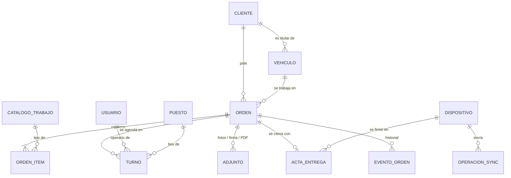
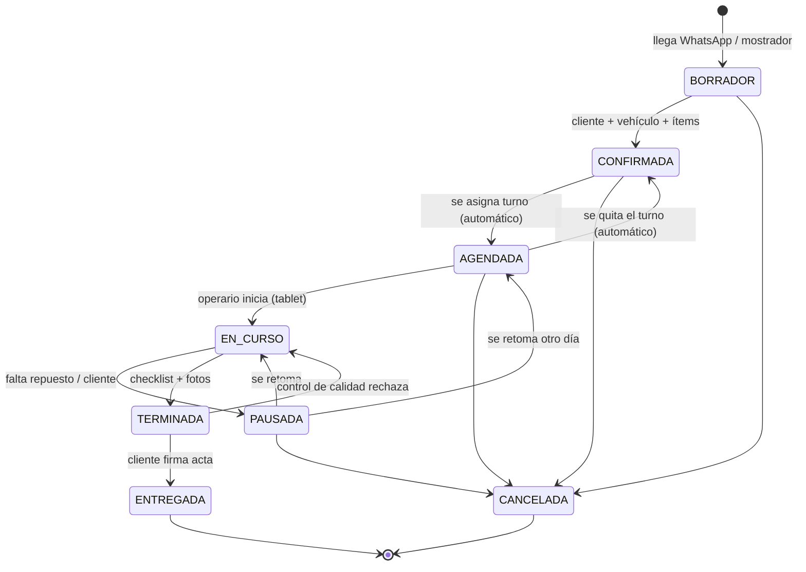
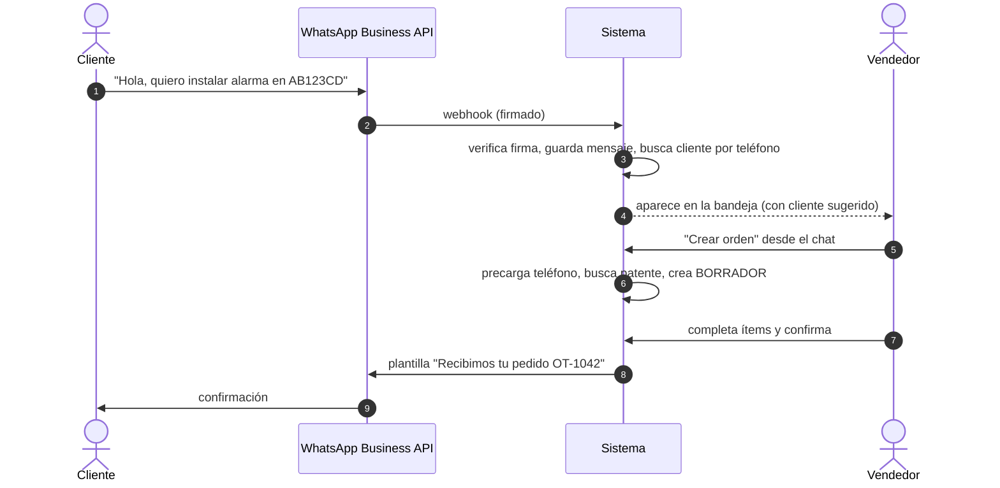
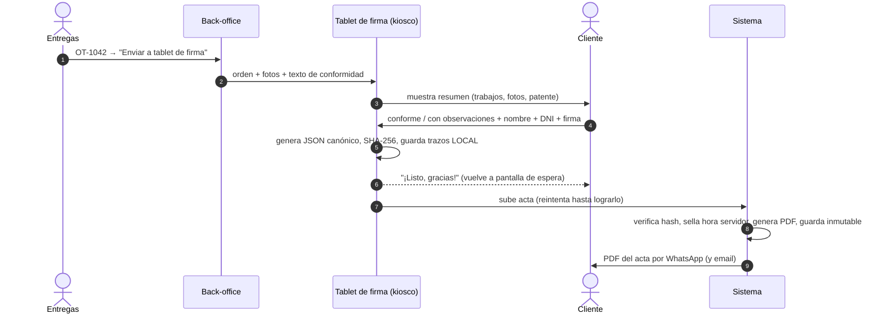
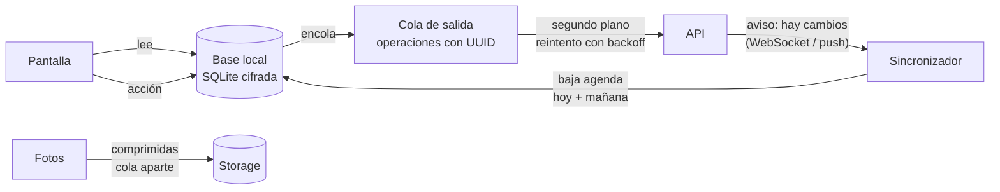
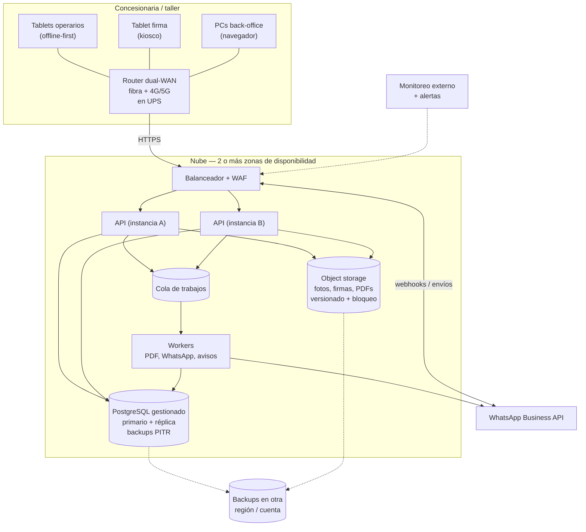

# Sistema de órdenes de instalación para concesionaria

Documento de diseño **v0.1**: lógica de negocio, arquitectura, seguridad, alta disponibilidad y plan B.

| Archivo | Qué es |
|---|---|
| `README.md` | Este documento: cómo funciona el sistema y por qué está diseñado así |
| [`PLAN-B.md`](PLAN-B.md) | Plan de contingencia operativo, para imprimir y tener en el taller |
| [`schema.sql`](schema.sql) | Modelo de datos en PostgreSQL con las reglas de negocio aplicadas en la base |
| [`pruebas_schema.sql`](pruebas_schema.sql) | 31 pruebas que verifican esas reglas (`psql -f schema.sql -f pruebas_schema.sql`) |

---

## 0. Resumen

1. **El cliente escribe por WhatsApp**. El mensaje entra a una bandeja en el sistema y quien atiende arma la **orden** desde la conversación. La orden queda asociada a un **cliente** (por teléfono y DNI/CUIT) y a un **vehículo** (por **patente**, o por VIN si es un 0km sin patente).
2. **El coordinador asigna la instalación en un calendario**: arrastra la orden al horario de un operario y un box. El sistema no permite superposiciones. La orden pasa sola a `AGENDADA` y **le llega al operario a la tablet**.
3. **El operario trabaja desde la tablet**: inicia, marca los ítems, saca fotos y cierra. **La tablet funciona aunque no haya internet.**
4. **En la entrega, el cliente firma en una tablet de firma** en modo kiosco. Se guarda un acta inmutable con hash, trazos de la firma, hora y dispositivo, y el cliente recibe el PDF por WhatsApp.
5. **Si algo falla** (internet, luz, servidor, WhatsApp, una tablet), hay un plan escrito para cada caso. El último recurso es un **talonario en papel**, que después se carga al sistema. Ver [`PLAN-B.md`](PLAN-B.md).

La decisión de arquitectura más importante es esta: **las tablets son *offline-first***. Leen y escriben en una base local y sincronizan en segundo plano. Por eso "vuelan" y por eso un corte de internet no frena el taller.

---

## 1. Actores

| Actor | Qué hace | Dónde |
|---|---|---|
| **Cliente** | Pide la instalación por WhatsApp; firma al retirar el vehículo | Su WhatsApp / tablet de firma |
| **Vendedor / atención** | Responde el WhatsApp, arma y confirma la orden | Back-office web (PC) |
| **Coordinador de taller** | Asigna turnos en el calendario, reprograma y resuelve conflictos | Back-office web (PC) |
| **Operario** | Recibe sus órdenes, ejecuta, marca ítems, saca fotos y cierra | Tablet de operario |
| **Entregas** | Presenta el acta al cliente en la tablet de firma | Back-office + tablet de firma |
| **Admin** | Usuarios, tablets, catálogo de trabajos, permisos | Back-office web |

---

## 2. Modelo de datos

### Reglas clave del dominio

- **Patente**: se guarda normalizada (`ab-123 cd` → `AB123CD`), con validación de formato argentino (viejo `ABC123`, Mercosur `AB123CD` y motos) y es **única**. Así cada vehículo tiene su historial de órdenes.
- **0km sin patente**: en una concesionaria pasa seguido. El vehículo se identifica por **VIN** (número de chasis) y la patente se completa después. La regla es "patente **o** VIN, al menos uno".
- **Cliente**: se busca por **teléfono de WhatsApp** (formato E.164, ej. `+5491155551234`) al entrar el mensaje, y se identifica de forma única por **DNI/CUIT**. El teléfono no es único: una familia o empresa puede compartirlo.
- **Patente ya asociada a otro cliente**: el sistema avisa ("¿cambio de titular?") y no bloquea.
- **Orden mínima para confirmar**: cliente + vehículo + al menos un ítem. Un *borrador* puede existir incompleto, porque nace de un chat donde los datos llegan de a poco.
- **Las órdenes no se borran, se cancelan.** Los turnos tampoco se borran. El acta y el historial son inmutables.

Todo esto lo hace cumplir la base de datos ([`schema.sql`](schema.sql)), no sólo la aplicación. Un bug en el código no puede dejar datos inconsistentes.

---

## 3. Ciclo de vida de la orden

| Transición | Quién | Condición que verifica la base |
|---|---|---|
| → `CONFIRMADA` | Vendedor | Tiene cliente, vehículo y ≥ 1 ítem |
| → `AGENDADA` | **Automático** al asignar turno | Hay un turno vigente |
| `AGENDADA` → `CONFIRMADA` | **Automático** al quitar el último turno | Queda "para reprogramar" |
| → `EN_CURSO` / `PAUSADA` / `TERMINADA` | Operario (tablet) | Transición válida |
| → `ENTREGADA` | Entregas (tablet de firma) | Existe acta firmada con hash válido |
| → `CANCELADA` | Vendedor / coordinador | Libera automáticamente los turnos del calendario |

Cada cambio queda en `evento_orden` con **quién**, **desde qué tablet** y **cuándo**. Ese historial no se puede editar.

---

## 4. Flujos

### 4.1 WhatsApp → orden

- Se usa la **API oficial de WhatsApp Business** (Cloud API, directo con Meta o mediante un proveedor/BSP), **no** la app de WhatsApp en un celular. Así todos ven la misma bandeja y queda registro.
- Detalle técnico importante: fuera de las **24 h** desde el último mensaje del cliente, sólo se pueden enviar **plantillas aprobadas** por Meta. Hay que tener aprobadas desde el día 1 las de confirmación, recordatorio de turno, vehículo listo y envío del acta.
- **Fase 2**: un bot que pida patente, nombre y DNI antes de pasar a un humano, para que el vendedor reciba el borrador ya armado.

### 4.2 Calendario y asignación

- **Vista día/semana por operario y por box**. Las órdenes `CONFIRMADA` aparecen en una columna "sin agendar" y se **arrastran** al calendario.
- La duración se propone desde el **catálogo de trabajos** (ej. alarma = 90 min) y se puede ajustar.
- Al soltar, el sistema valida que el operario esté activo y que **no haya superposición ni del operario ni del box**. Esto lo garantiza la base con una restricción de exclusión, así que es imposible incluso con dos coordinadores agendando a la vez.
- Al asignar: la orden pasa a `AGENDADA`, **se notifica a la tablet del operario** (llega en segundos) y opcionalmente se manda un WhatsApp de confirmación al cliente.
- **Reprogramar** = arrastrar a otro horario. La tablet del operario se actualiza sola.
- Varios turnos por orden son válidos (dos operarios juntos o un trabajo de varios días).

### 4.3 Tablet del operario

1. Abre la app y entra con **PIN** de 4 a 6 dígitos. Es rápido, y sólo vale en una tablet enrolada (ver [Seguridad](#7-seguridad)).
2. Ve **"Mis órdenes de hoy"**, que ya están en la tablet desde antes: no se descarga nada en ese momento.
3. **Iniciar** → checklist de ítems → **fotos antes/después** → **Pausar** (con motivo) o **Terminar**.
4. Cada toque responde al instante. La sincronización pasa por detrás (ver §5).

### 4.4 Entrega y firma del cliente

- La tablet de firma está en **modo kiosco**: el cliente no puede salir de la app ni ver otras órdenes. Si pasan 2 minutos sin actividad, vuelve a la pantalla de espera y descarta lo que no se firmó.
- **Si no hay internet**, el back-office no puede "enviar" la orden. Por eso la tablet de firma ya tiene precargadas las órdenes `TERMINADA` del día: el empleado de entregas la elige en la tablet con su PIN y se la pasa al cliente.
- El acta guarda: **contenido exacto que vio el cliente + hash SHA-256 + trazos de la firma** (puntos con tiempo y presión, no sólo una imagen) **+ hora de la tablet + hora del servidor + tablet + empleado**. La base rechaza un acta cuyo hash no coincide con el contenido, y no permite modificarla ni borrarla.
- Mandarle el PDF al cliente en el momento es una evidencia fuerte de que recibió y aceptó el trabajo.

> ⚖️ **Validez legal (verificar con un abogado):** en Argentina, una firma hecha en tablet es una **firma electrónica** (Ley 25.506), no una *firma digital*. Si el cliente la desconoce, quien la invoca tiene que probar su validez. Por eso el diseño guarda toda la evidencia de arriba. También hay que definir con legal el texto de conformidad, el plazo de conservación (como referencia, la documentación comercial se suele guardar 10 años) y las obligaciones de la Ley 25.326 de datos personales.

### 4.5 Recomendación: acta de **recepción** también

Conviene sumar un acta firmada **al recibir** el vehículo, con fotos del estado previo (rayones, golpes) y kilometraje. Es el mismo flujo de firma y evita los reclamos de "esto me lo rayaron ustedes". Está anotado como pregunta abierta (§11).

---

## 5. Tablets que "vuelan" — diseño offline-first

### El principio

> **La tablet nunca espera a la red.** Toda pantalla lee de la base local y toda acción se guarda local primero. La red sólo se usa en segundo plano.

Las apps que "se traban" casi siempre están esperando una respuesta del servidor con una conexión Wi-Fi mala, cosa común en un taller con chapa y autos por todos lados. Si la app no depende de la red, ese problema desaparece.

### Cómo sincroniza

- **Subida (tablet → servidor)**: cada acción (iniciar, marcar ítem, pausar, terminar, firmar) es una **operación con ID propio** (UUIDv7) que va a una cola local. Se envía en segundo plano y se reintenta hasta que el servidor confirma. Si llega dos veces, el servidor la reconoce por el ID y **no la aplica dos veces** (probado en `pruebas_schema.sql`).
- **Bajada (servidor → tablet)**: con el volumen de un taller, unas decenas de órdenes por día, la tablet baja **la agenda completa del operario para hoy y mañana** en cada sincronización. Son pocos KB y **evita toda la complejidad y los bugs de una sincronización incremental**. La sincronización se dispara por aviso del servidor (WebSocket o push), al volver a la app y cada 60 segundos como respaldo.
- **Fotos**: se comprimen en la tablet (≈1600 px, ~300 KB) y suben por una **cola separada**. Terminar una orden no espera a que suban las fotos.
- **Indicador siempre visible**: 🟢 sincronizado · 🟡 *N* pendientes · 🔴 sin conexión hace *X* min. El operario sabe en qué estado está, y el back-office ve el mismo semáforo por tablet (vista `vista_estado_tablets`).

### Conflictos: qué pasa si dos personas cambian lo mismo

| Caso | Regla |
|---|---|
| Operario inicia sin internet, mientras la oficina reprograma o cancela | **Lo que pasó en el taller es un hecho**: se registra igual, la operación queda como `CONFLICTO` y aparece en una **bandeja de conflictos** del coordinador. Nunca se pierde en silencio. |
| Dos coordinadores editan la misma orden | Concurrencia optimista: gana el primero y el segundo ve "la orden cambió, recargá" (columna `version`). |
| Dos turnos al mismo operario u horario | Imposible: lo rechaza la base. |
| Reloj de la tablet desfasado | Se guarda hora de tablet **y** hora del servidor; el MDM fuerza hora automática. |

Cada dato tiene un **dueño**: la oficina es dueña de la agenda y de los datos de la orden, y el taller es dueño de la ejecución. Eso reduce los conflictos reales a casos raros que van a la bandeja.

### Objetivos de rendimiento (criterios de aceptación)

| Acción | Objetivo |
|---|---|
| Abrir app → ver órdenes del día | < 1 s, **sin red** |
| Cualquier toque → respuesta visual | < 100 ms |
| Pantallas con spinner esperando red | **Ninguna** |
| Sacar foto → volver a la orden | < 1 s (la subida va por detrás) |
| Trazo de firma | Fluido, sin lag |
| Cambio en oficina → visible en tablet (con red) | < 5 s |

### Hardware y gestión de las tablets

- **Tablets Android de gama media o superior** (≥ 4 GB de RAM, Android reciente y compatible con Android Enterprise). Para la de firma conviene sumar un **lápiz** pasivo, y para las de taller una **funda reforzada**.
- **MDM (gestión de dispositivos)**, por ejemplo Intune, ManageEngine, Hexnode, Scalefusion o cualquiera basado en Android Enterprise. Con el MDM:
  - **Modo kiosco / dispositivo dedicado**: sólo corre nuestra app y no se instalan otras cosas.
  - Actualizaciones de la app y del sistema **fuera del horario de trabajo**, primero en **una tablet piloto**.
  - App excluida del ahorro de batería, para que el sistema no la cierre.
  - **Borrado remoto** si se pierde o la roban.
- **Wi-Fi del taller**: access points profesionales, con la cobertura **medida en cada box** y una red separada para las tablets (no compartida con clientes).
- **Una tablet de reserva** enrolada, cargada y lista para reemplazar a cualquiera en 5 minutos.

### ¿App nativa o PWA?

| | App Android (React Native / Flutter + SQLite) | PWA (web instalable) |
|---|---|---|
| Rendimiento y offline | ✅ Mejor y más predecible | ⚠️ Bueno, pero depende del navegador |
| Cámara, kiosco, segundo plano | ✅ Completo | ⚠️ Limitado |
| Desarrollo | Un equipo más | Mismo stack que el back-office |

**Recomendación: app Android nativa** (React Native o Flutter) para las tablets, porque el requisito "no se puede trabar" es el más importante. El back-office es web.

---

## 6. Arquitectura

### Stack recomendado (aburrido a propósito)

| Componente | Recomendación | Por qué |
|---|---|---|
| Base de datos | **PostgreSQL gestionado con HA** (RDS Multi-AZ, Cloud SQL HA o Azure Flexible con redundancia de zona) | Las reglas viven en la base ([`schema.sql`](schema.sql)), failover automático y backups punto-en-el-tiempo |
| API | Node.js (NestJS) o Python (FastAPI), **sin estado**, en contenedores con ≥ 2 instancias | Si cae una, la otra atiende |
| Back-office | Web (React) con un componente de calendario (ej. FullCalendar) | Arrastrar y soltar turnos |
| Tablets | React Native o Flutter + SQLite cifrada (SQLCipher) | Offline-first real |
| Archivos | Object storage S3-compatible con **versionado y bloqueo de objetos** para actas | Las actas no se pueden borrar ni pisar |
| Tiempo real | WebSocket/SSE + push (FCM) + polling de respaldo | Tres caminos para que el aviso llegue |
| PDF | Generado en un worker desde el mismo JSON canónico que firmó el cliente | Lo que se firmó es lo que se imprime |
| Monitoreo | Chequeo externo de disponibilidad + logs + alertas a WhatsApp/email del responsable | Enterarse antes que el taller |

---

## 7. Seguridad

**Identidad y acceso**
- Back-office: usuario + contraseña (argon2id) + **2FA obligatorio** para admin y coordinadores.
- Tablets: **cada tablet se enrola** y genera un par de claves que queda registrado (`dispositivo.clave_publica`). La API **sólo acepta tablets enroladas y activas**. Por eso al operario le alcanza un PIN corto: el PIN sin la tablet no sirve, y la tablet sin el PIN tampoco.
- **Roles**: el operario ve **sólo sus órdenes**; la tablet de firma ve **sólo la orden que se le envió** (o las terminadas del día en modo autónomo); el vendedor no puede tocar actas.
- Tokens de corta duración atados al dispositivo. **Revocar una tablet** (pérdida o robo) corta su acceso al instante y el MDM la borra.

**Datos**
- TLS en todo (HSTS). Cifrado en reposo en la base, el storage y los backups.
- Base local de la tablet **cifrada** (SQLCipher) + cifrado del dispositivo.
- Webhooks de WhatsApp: se verifica la **firma HMAC** (`X-Hub-Signature-256`). Si no coincide, el mensaje se descarta.
- Secretos en un gestor de secretos, nunca en el código.

**Trazabilidad e integridad**
- Historial de la orden **append-only** (no se edita ni se borra; lo garantiza la base).
- Acta de entrega **inmutable** con hash verificado por la base + storage con bloqueo de objetos.

**Protección operativa**
- WAF y límites de tasa en la API.
- Backups **en otra cuenta/región, inmutables**, para que un ransomware o un error humano no los alcance.
- **Prueba de restauración mensual**: un backup que nunca se restauró no es un backup.
- Ley 25.326: aviso de privacidad al cliente, acceso mínimo necesario y, si corresponde, inscripción de la base ante la AAIP (verificar con legal).

---

## 8. Alta disponibilidad

El objetivo real no es "el servidor nunca se cae". Es que **el taller no se frene aunque algo se caiga**. Eso se logra por capas:

| Capa | Cómo | Si falla… |
|---|---|---|
| Tablets | Offline-first | Siguen trabajando horas sin servidor ni internet |
| Internet del local | Router **dual-WAN**: fibra + 4G/5G con conmutación automática | Cambia a 4G en segundos |
| Energía del local | **UPS** para router, ONT y access points | 30–60 min de autonomía; las tablets tienen batería |
| API | ≥ 2 instancias en zonas distintas detrás de un balanceador | La otra instancia atiende |
| Base de datos | Primario + réplica en otra zona con failover automático | Failover en minutos |
| Datos | Backups continuos (PITR) + copia inmutable en otra región | Se restaura con pérdida de pocos minutos |
| Región entera | Restaurar en otra región desde backup (procedimiento escrito y probado) | Horas, cubiertas por el modo offline y el plan papel |

**Objetivos propuestos**: disponibilidad del back-office ≥ 99,9 % (≈ 45 min de caída al mes como máximo), **RPO ≤ 5 min** (cuántos datos se pueden perder) y **RTO ≤ 1 h** ante falla de zona (cuánto se tarda en volver). Para el taller, el objetivo es **0 minutos de parada** gracias al modo offline.

---

## 9. Plan B — resumen

El detalle paso a paso está en [`PLAN-B.md`](PLAN-B.md). Resumen:

| Escenario | Respuesta automática | Acción manual |
|---|---|---|
| **Se corta internet** | Router pasa a 4G; tablets siguen offline | Si cae también el 4G: hotspot de un celular de la empresa |
| **Se corta la luz** | UPS mantiene la red; tablets con batería | Corte largo: modo offline + plan papel |
| **Se cae el sistema (nube)** | Failover; tablets siguen offline | Usar la **agenda impresa del día** (llega por email cada mañana) |
| **Se cae WhatsApp / bloquean el número** | Avisos por email/SMS | Atender por teléfono y cargar la orden con origen `TELEFONO` |
| **Se rompe o pierden una tablet** | — | Tablet de reserva + revocar la otra desde el back-office |
| **Bug en una versión nueva** | Despliegue escalonado | Volver a la versión anterior desde el MDM |
| **Todo falla** | — | **Talonario de papel numerado** (`C-0001`…) que después se carga con origen `CONTINGENCIA_PAPEL` y foto escaneada |

Dos cosas baratas que valen oro:
1. **Agenda impresa automática**: cada mañana a las 7:00 el sistema manda por email el PDF con la agenda del día y del siguiente. Si todo se cae, el taller sabe igual qué hacer.
2. **Simulacro trimestral**: desconectar internet a propósito 30 minutos un día de poco trabajo y verificar que el plan funciona.

---

## 10. Plan por fases

| Fase | Entrega | Criterio de "listo" |
|---|---|---|
| **0. Preparación** | Relevamiento (preguntas §11), compra de tablets + MDM + router dual-WAN + UPS, alta de WhatsApp Business API y plantillas, talonarios de contingencia impresos | Hardware enrolado; plantillas aprobadas |
| **1. MVP** | Back-office (clientes, vehículos, órdenes, calendario), app de operario offline, tablet de firma con acta PDF | Una semana real en el taller sin papel y sin quejas de "se traba" |
| **2. WhatsApp integrado** | Bandeja de chats, crear orden desde el chat, avisos automáticos (confirmación, recordatorio, listo, acta) | Las órdenes nacen en el chat |
| **3. Operación madura** | Tablero de tablets, bandeja de conflictos, reportes (tiempos, productividad), bot de WhatsApp, acta de recepción | Métricas visibles para la gerencia |

**Recomendación:** antes de construir, hacer un **prototipo de la app de tablet** y probarlo una semana con 1–2 operarios reales. Es la parte con más riesgo de rechazo.

---

## 11. Preguntas abiertas (para cerrar la lógica)

1. **¿Qué se instala?** Accesorios, alarmas, polarizado, GNC, multimedia… ¿Hay un catálogo con **duración estimada** de cada trabajo?
2. **¿Cuántos operarios, boxes y sucursales?** ¿Los turnos son por hora o por día?
3. **¿Los vehículos son 0km** (sin patente al momento de la orden), usados, o de clientes que vienen de afuera?
4. **¿La orden tiene precio, seña o factura?** ¿Hay que integrarse con un sistema de gestión, facturación o DMS que ya usen?
5. **¿Quién arma la orden** y quién puede reprogramar o cancelar?
6. **¿Se firma también al recibir el vehículo** (estado previo, fotos de daños, km)? (recomendado, §4.5)
7. **¿Las fotos son obligatorias** para terminar? ¿Cuántas y de qué?
8. **¿Hay control de calidad** antes de entregar? ¿Quién lo hace?
9. **¿Ya tienen tablets?** ¿Android o iPad? ¿Cómo es hoy el Wi-Fi del taller?
10. **¿Ya tienen número de WhatsApp Business?** ¿Lo usan en un celular con la app o ya con la API?
11. **¿Qué tan seguido** se corta internet o la luz hoy?
12. **¿Qué texto de conformidad** firma el cliente? (validar con legal)
